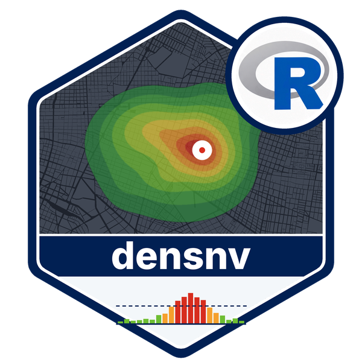

<!-- README.es.md se genera a partir de README.es.Rmd. Edite ese archivo -->

# densnv 

<!-- badges: start -->

[](https://fdzul.r-universe.dev/densnv)
[](https://lifecycle.r-lib.org/articles/stages.html#stable)
[](https://www.repostatus.org/#active)
<!-- badges: end -->

[English](README.md) \| **Español**

El objetivo central del paquete densnv es realizar el análisis
exploratorio de las bases de datos de las Enfermedades Transmitidas por
Vector (ETV) e Intoxicación por Veneno de Artrópodos (IVA) del Sistema
Nacional de Vigilancia Epidemiológica
([SINAVE](https://www.sinave.gob.mx)) de la Secretaría de Salud de
México, a través de gráficos, tablas y mapas, con el objetivo de incidir
de manera directa en la toma de decisiones racionales y oportunas en los
programas de prevención y control de las ETV.

densnv forma parte del [dengueverse](https://fdzul.github.io/dengueverse/es/), un
conjunto de paquetes de R para el análisis de la transmisión del dengue
en México.

## Instalación

La versión en desarrollo del paquete densnv está alojada en
[GitHub](https://github.com/fdzul/densnv) y en
[R-universe](https://fdzul.r-universe.dev). Se puede instalar con
[pak](https://pak.r-lib.org), [remotes](https://remotes.r-lib.org) o
[devtools](https://devtools.r-lib.org):

``` r
# desde R-universe (binarios, más rápido)
install.packages("densnv",
                 repos = c("https://fdzul.r-universe.dev",
                           "https://cloud.r-project.org"))

# desde GitHub
# install.packages("pak")
pak::pkg_install("fdzul/densnv")
```

## Funciones

Las funciones están organizadas en grupos identificados por su prefijo:

- **read**: cargan las bases de datos del SINAVE en R (`read()`,
  `read_dengue_dataset()`).

- **cases**: agregan los casos por municipio, localidad o semana
  epidemiológica (`cases_by_agem()`, `cases_by_loc()`, `cases_week()`).

- **plt**: generan gráficos (`plt_heatmap()`, `plt_pyramid()`,
  `plt_serotype()`, `plt_treemap()`).

- **mp**: generan mapas estáticos, animados e interactivos
  (`mp_active_foci()`, `mp_animated_loc()`, `mp_animated_mpo()`,
  `mp_bumpmap()`, `mp_cases_loc()`, `mp_heatmap()`, `mp_heatmap_edo()`,
  `mp_serotype()`).

- **tb**: generan tablas (`tb_conf()`).

- **rt**: estiman el número reproductivo efectivo (`rt_dengue()`).

- **geocodificación**: preparan, geocodifican y guardan los domicilios
  de los casos (`data_geocode()`, `geocode()`, `save_geocode()`).

## Focos de transmisión activa y escenarios epidemiológicos

`mp_active_foci()` identifica los focos de transmisión activa con DBSCAN
espacio-temporal (por defecto, 3 o más casos a 400 m o menos, el rango
de vuelo de *Aedes aegypti*, y dentro de la ventana temporal), delimita
las zonas de transmisión y de control, y selecciona las manzanas a
intervenir. Además:

1.  Evalúa la interacción espacio-temporal con la prueba de Knox (global
    y por foco) con permutaciones Monte Carlo.

2.  Estima el número reproductivo efectivo (Rt) de la localidad con
    `rt_dengue()`.

3.  Diagnostica el escenario epidemiológico (transmisión generalizada,
    focalizada, focalizada con casos dispersos o sin focos activos) con
    los criterios de incremento sostenido y significativo, capacidad
    operativa y dispersión de los casos, y propone la estrategia
    operativa (estrategia focalizada, barrido u operativo integral, y
    alerta temprana).

``` r
library(densnv)

res <- mp_active_foci(geocoded_dataset = z,      # casos geocodificados (long, lat)
                      cve_edo = "31",
                      locality = "Merida",
                      status_caso = c(1, 2),
                      spatial_scale = 400,
                      temporal_scale = 28,
                      min_cases = 3,
                      buffer_m = 0,
                      ref_date = NULL,
                      method = "st-dbscan",
                      n_sim = 999,
                      perm_days = 365,
                      alpha = 0.05,
                      seed = 123,
                      place = "REP",
                      mean_si = 21,
                      std_si = 6.1,
                      capacity_cases = NULL,
                      coverage_min = NULL,
                      foci_min = 0.9,
                      save = FALSE,
                      dir = "./")

res$foci                   # resumen de los focos activos
res$blocks                 # manzanas a controlar
res$knox                   # prueba de Knox global
res$diagnostico$tabla      # escenario, criterios y acción
res$diagnostico$rt_plot    # curva del Rt
```

`rt_dengue()` también se puede usar sola, a nivel país, estado,
municipio o localidad:

``` r
rt <- rt_dengue(dataset = dataset,
                level = "state",
                place = "REP",
                cve_edo = "12",
                status_caso = c(1, 2),
                ref_date = NULL,
                period_days = 365,
                window_days = 28,
                mean_si = 21,
                std_si = 6.1,
                plot = TRUE)
rt$rt_ventana
```

## Créditos

Las bases de datos de las Enfermedades Transmitidas por Vector (ETV) e
Intoxicación por Veneno de Artrópodos (IVA) del Sistema Nacional de
Vigilancia Epidemiológica ([SINAVE](https://www.sinave.gob.mx)) de la
Secretaría de Salud de México son bases para uso exclusivo del personal
de las Secretarías de Salud de los Estados y del nivel federal.

Los shapefiles originales son elaborados por instituciones oficiales del
gobierno de México ([INEGI](https://www.inegi.org.mx/temas/mg) e
[INE](https://pautas.ine.mx/transparencia/mapas/)).

Métodos y paquetes en los que se basan las funciones:

- DBSCAN: Hahsler M, Piekenbrock M, Doran D (2019). dbscan: Fast
  Density-Based Clustering with R. *Journal of Statistical Software*,
  91(1), 1-30. <https://doi.org/10.18637/jss.v091.i01>

- Prueba de Knox: Knox EG (1964). The detection of space-time
  interactions. *Journal of the Royal Statistical Society, Series C*,
  13(1), 25-30.

- Rt: Cori A, Ferguson NM, Fraser C, Cauchemez S (2013). A new framework
  and software to estimate time-varying reproduction numbers during
  epidemics. *American Journal of Epidemiology*, 178(9), 1505-1512
  ([EpiEstim](https://CRAN.R-project.org/package=EpiEstim)).

## Licencia

Este proyecto tiene la licencia MIT; consulte el archivo
[LICENSE.md](LICENSE.md) para más detalles.

## Inspiración

El paquete se inspiró en la necesidad de contribuir a la toma de
decisiones en el programa de prevención y control del dengue,
específicamente a través de la identificación de los escenarios
operativos de la transmisión activa.

## Ayuda

Si encuentra un error en el código, presente un ejemplo mínimo
reproducible en [GitHub](https://github.com/fdzul/densnv/issues). Para
preguntas y otras discusiones, no dude en contactarme
(<felipe.dzul.m@gmail.com>).

------------------------------------------------------------------------

Tenga en cuenta que este proyecto se publica con un [Código de
Conducta](https://dplyr.tidyverse.org/CODE_OF_CONDUCT). Al participar en
este proyecto usted acepta cumplir con sus términos.
