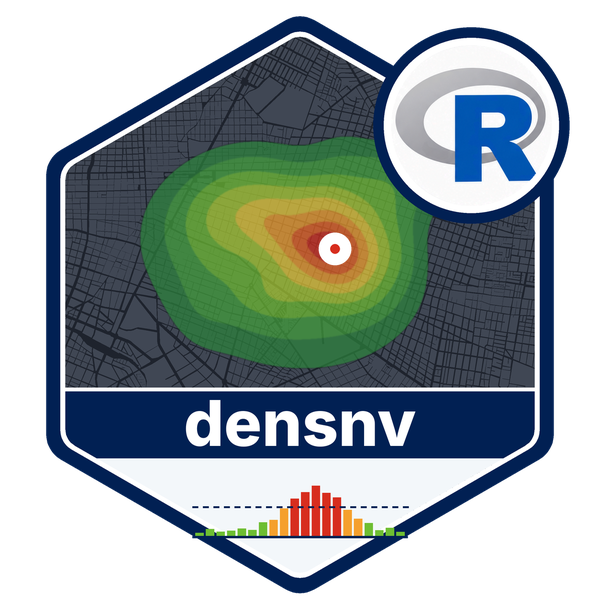

<!-- README.md is generated from README.Rmd. Please edit that file -->

# densnv 

<!-- badges: start -->

[](https://fdzul.r-universe.dev/densnv)
<!-- badges: end -->

**English** \| [Español](README.es.md)

The main goal of densnv is the exploratory analysis of the Vector-Borne
Diseases (VBD) and Arthropod Venom Poisoning datasets of the National
Epidemiological Surveillance System
([SINAVE](https://www.sinave.gob.mx)) of the Ministry of Health of
Mexico, through graphs, tables and maps, to support rational and timely
decisions in the VBD prevention and control programs.

densnv is part of the [dengueverse](https://fdzul.github.io/dengueverse/), a set
of R packages for the analysis of dengue transmission in Mexico.

## Installation

The development version of densnv is hosted on
[GitHub](https://github.com/fdzul/densnv) and
[R-universe](https://fdzul.r-universe.dev). It can be installed with
[pak](https://pak.r-lib.org), [remotes](https://remotes.r-lib.org) or
[devtools](https://devtools.r-lib.org):

``` r
# from R-universe (binaries, faster)
install.packages("densnv",
                 repos = c("https://fdzul.r-universe.dev",
                           "https://cloud.r-project.org"))

# from GitHub
# install.packages("pak")
pak::pkg_install("fdzul/densnv")
```

## Functions

The functions are grouped by prefix:

- **read**: load the SINAVE datasets into R (`read()`,
  `read_dengue_dataset()`).

- **cases**: aggregate the cases by municipality, locality or
  epidemiological week (`cases_by_agem()`, `cases_by_loc()`,
  `cases_week()`).

- **plt**: graphs (`plt_heatmap()`, `plt_pyramid()`, `plt_serotype()`,
  `plt_treemap()`).

- **mp**: static, animated and interactive maps (`mp_active_foci()`,
  `mp_animated_loc()`, `mp_animated_mpo()`, `mp_bumpmap()`,
  `mp_cases_loc()`, `mp_heatmap()`, `mp_heatmap_edo()`,
  `mp_serotype()`).

- **tb**: tables (`tb_conf()`).

- **rt**: effective reproductive number (`rt_dengue()`).

- **geocoding**: prepare, geocode and save the addresses of the cases
  (`data_geocode()`, `geocode()`, `save_geocode()`).

## Active transmission foci and epidemiological scenarios

`mp_active_foci()` identifies the active transmission foci with
space-time DBSCAN (by default, 3 or more cases within 400 m, the flight
range of *Aedes aegypti*, and within the temporal window), delimits the
transmission and control zones and selects the blocks to treat. It also:

1.  Tests the space-time interaction with the Knox test (global and by
    focus), with Monte Carlo permutations.

2.  Estimates the effective reproductive number (Rt) of the locality
    with `rt_dengue()`.

3.  Diagnoses the epidemiological scenario (generalised transmission,
    focalised transmission, focalised transmission with dispersed cases
    or no active foci) with the criteria of sustained and significant
    increase, operational capacity and dispersion of the cases, and
    proposes the operational strategy (focalised strategy, *barrido* or
    *operativo integral*, and early warning).

``` r
library(densnv)

res <- mp_active_foci(geocoded_dataset = z,      # geocoded cases (long, lat)
                      cve_edo = "31",
                      locality = "Merida",
                      status_caso = c(1, 2),
                      spatial_scale = 400,
                      temporal_scale = 28,
                      min_cases = 3,
                      buffer_m = 0,
                      ref_date = NULL,
                      method = "st-dbscan",
                      n_sim = 999,
                      perm_days = 365,
                      alpha = 0.05,
                      seed = 123,
                      place = "REP",
                      mean_si = 21,
                      std_si = 6.1,
                      capacity_cases = NULL,
                      coverage_min = NULL,
                      foci_min = 0.9,
                      save = FALSE,
                      dir = "./")

res$foci                   # summary of the active foci
res$blocks                 # blocks to treat
res$knox                   # global Knox test
res$diagnostico$tabla      # scenario, criteria and action
res$diagnostico$rt_plot    # Rt curve
```

`rt_dengue()` can also be used on its own, for the country, a state, a
municipality or a locality:

``` r
rt <- rt_dengue(dataset = dataset,
                level = "state",
                place = "REP",
                cve_edo = "12",
                status_caso = c(1, 2),
                ref_date = NULL,
                period_days = 365,
                window_days = 28,
                mean_si = 21,
                std_si = 6.1,
                plot = TRUE)
rt$rt_ventana
```

The outputs (scenarios, actions and maps) are in Spanish, the language
of the users of the Mexican VBD program.

## Credits

The Vector-Borne Diseases (VBD) and Arthropod Venom Poisoning datasets
of the National Epidemiological Surveillance System
([SINAVE](https://www.sinave.gob.mx)) of the Ministry of Health of
Mexico are for the exclusive use of the staff of the State Ministries of
Health and of the federal level.

Original shapefiles are created by official government institutions
([INEGI](https://www.inegi.org.mx/temas/mg) &
[INE](https://pautas.ine.mx/transparencia/mapas/)).

Methods and packages the functions are based on:

- DBSCAN: Hahsler M, Piekenbrock M, Doran D (2019). dbscan: Fast
  Density-Based Clustering with R. *Journal of Statistical Software*,
  91(1), 1-30. <https://doi.org/10.18637/jss.v091.i01>

- Knox test: Knox EG (1964). The detection of space-time interactions.
  *Journal of the Royal Statistical Society, Series C*, 13(1), 25-30.

- Rt: Cori A, Ferguson NM, Fraser C, Cauchemez S (2013). A new framework
  and software to estimate time-varying reproduction numbers during
  epidemics. *American Journal of Epidemiology*, 178(9), 1505-1512
  ([EpiEstim](https://CRAN.R-project.org/package=EpiEstim)).

## License

This project is licensed under the MIT license; see the
[LICENSE.md](LICENSE.md) file for details.

## Inspiration

The package was inspired by the need to support decision making in the
dengue prevention and control program, specifically through the
identification of the operational scenarios of active transmission.

## Help

If you find a bug, please file a minimal reproducible example on
[GitHub](https://github.com/fdzul/densnv/issues). For questions and
other discussions, feel free to contact me (<felipe.dzul.m@gmail.com>).

------------------------------------------------------------------------

Please note that this project is released with a [Contributor Code of
Conduct](https://dplyr.tidyverse.org/CODE_OF_CONDUCT). By participating
in this project you agree to abide by its terms.
