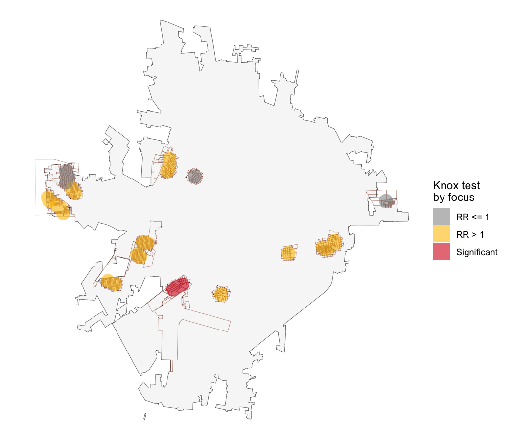
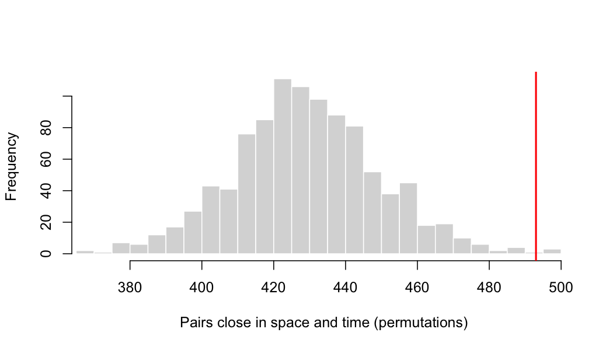
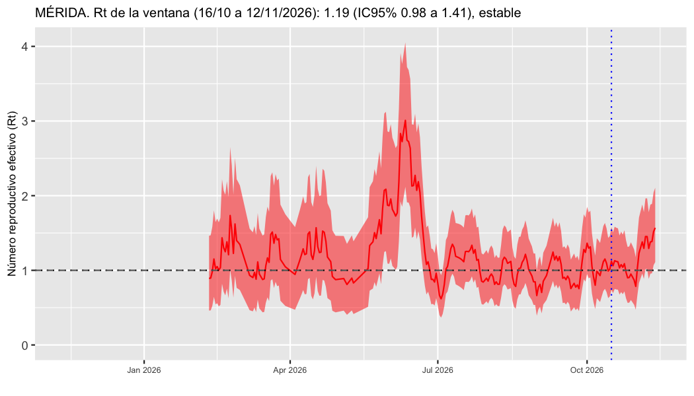

<!-- Precomputed vignette. Edit active_foci.Rmd.orig (not the .Rmd) and rebuild
     on the computer with the data, from the vignettes/ folder:
     knitr::knit("active_foci.Rmd.orig", "active_foci.Rmd")
     CONFIDENTIALITY: do not print res$cases, coordinates or maps with the cases. -->


[Versión en español](focos_activos.html)

## Introduction

An **active transmission focus** is a group of dengue cases close in space and time, which shows that the virus is circulating now in a bounded area. Identifying it directs vector control to the blocks where transmission is happening, instead of the whole city.

The `mp_active_foci()` function of **densnv**:

1. Identifies the active foci with space-time DBSCAN.
2. Delimits the transmission and control zones, and selects the blocks to treat.
3. Tests whether the cases are more clustered in space and time than expected by chance (Knox test).
4. Estimates the effective reproductive number (Rt) of the locality with `rt_dengue()`.
5. Diagnoses the epidemiological scenario and proposes the operational strategy.
6. Returns an interactive map with the foci, zones, blocks and cases.

The outputs (scenarios, actions and map labels) are in Spanish, the language of the users of the Mexican vector-borne disease program.


``` r
library(densnv)
```

## Data

The function uses the SINAVE dengue dataset with **geocoded** cases. The required columns are:


|column                                |use                                        |
|:-------------------------------------|:------------------------------------------|
|long, lat                             |Coordinates of the address (EPSG:4326)     |
|ESTATUS_CASO                          |Case status: 1 probable, 2 confirmed       |
|FEC_INI_SIGNOS_SINT                   |Date of onset of symptoms                  |
|CVE_EDO_REP, CVE_MPO_REP, CVE_LOC_REP |Locality of report, for Rt (place = "REP") |


``` r
load("/Users/fdzul/Documents/geocoding_mx_2026_dengue/4.RData/dengue_mx_2026.RData")

```


## Parameters and rationale


|argument       |default  |rationale                                                                                                 |
|:--------------|:--------|:---------------------------------------------------------------------------------------------------------|
|spatial_scale  |400      |Flight range of Aedes aegypti (metres)                                                                    |
|temporal_scale |21       |Intrinsic + extrinsic incubation period (days); the program uses 28 days (4 weeks) as active transmission |
|min_cases      |3        |Minimum cases in the space-time neighbourhood to form a focus                                             |
|buffer_m       |200      |Buffer around the transmission zone for control (100 m is about one block)                                |
|method         |"window" |"window": only the cases of the window; "st-dbscan": transmission chains, new and persistent foci         |
|perm_days      |365      |Days of cases for the Knox test, Rt and ST-DBSCAN                                                         |
|n_sim          |999      |Permutations of the Knox test                                                                             |


Distances are computed in metres with the **Mexico ITRF2008 / LCC (EPSG:6372)** projection, with a scale error below 1% over the whole country.

## How it works

1. **Locality:** the locality polygon is extracted with `rgeomex::extract_locality()` and the cases are clipped to it.
2. **Spatial and temporal window:** the window is the `temporal_scale` days up to `ref_date` (by default, the latest onset).
3. **DBSCAN** ([dbscan](https://doi.org/10.18637/jss.v091.i01) package): a case is a *core* case if there are at least `min_cases` cases (itself included) within `spatial_scale` metres and, with ST-DBSCAN, within `temporal_scale` days. Neighbouring core cases form the same focus. A focus is **active** if it has at least one case in the window.
4. **Zones:** the transmission zone is the union of circles of `spatial_scale` metres around the recent cases of the focus; the control zone adds `buffer_m` metres. The blocks (INE 2020) that touch the control zone are selected.
5. **Knox test, Rt and diagnosis** (next sections).
6. **Interactive map** (mapgl), with basemaps and layers in a collapsible control.

## Example: Mérida


``` r
res <- mp_active_foci(geocoded_dataset = z,
                      cve_edo = "31",
                      locality = "Merida",
                      status_caso = c(1, 2),
                      spatial_scale = 400,
                      temporal_scale = 28,
                      min_cases = 3,
                      buffer_m = 0,
                      ref_date = NULL,
                      method = "st-dbscan",
                      n_sim = 999,
                      perm_days = 365,
                      alpha = 0.05,
                      seed = 123,
                      place = "REP",
                      mean_si = 21,
                      std_si = 6.1,
                      capacity_cases = NULL,
                      coverage_min = NULL,
                      foci_min = 0.9,
                      print_map = FALSE,
                      save = FALSE,
                      dir = "./")
```

The function returns a list with the interactive map (`res$map`), the foci (`res$foci`), the transmission zones (`res$transmission`), the blocks to treat (`res$blocks`), the cases (`res$cases`), the Knox test (`res$knox`) and the diagnosis (`res$diagnostico`).

Summary of the active foci:


``` r
sf::st_drop_geometry(res$foci)[, c("foco", "tipo", "casos", "casos_recientes",
                                   "duracion_dias", "area_transmision_km2",
                                   "manzanas")]
#> # A tibble: 13 × 7
#>     foco tipo        casos casos_recientes duracion_dias area_transmision_km2
#>    <int> <chr>       <int>           <int>         <dbl>                <dbl>
#>  1     1 Persistente    35               5           172                 1.4 
#>  2     2 Persistente     8               3            78                 0.98
#>  3     3 Persistente     9               2            59                 0.85
#>  4     4 Persistente     3               1            21                 0.5 
#>  5     5 Persistente     8               5            36                 1.28
#>  6     6 Persistente     5               3            22                 0.5 
#>  7     7 Persistente     4               2            14                 0.51
#>  8     8 Persistente     3               2            23                 0.68
#>  9     9 Persistente     3               2            15                 0.74
#> 10    10 Persistente     3               2            19                 0.5 
#> 11    11 Nuevo           3               3            25                 0.97
#> 12    12 Nuevo           3               3             8                 1.04
#> 13    13 Nuevo           4               4            16                 1.1 
#> # ℹ 1 more variable: manzanas <int>
```

Transmission zones and blocks to treat (for confidentiality, the figure does not show the cases):

<div class="figure">

<p class="caption">plot of chunk map_zones</p>
</div>

## Knox test

Are the foci real, or could they appear by chance? The **Knox test** counts the **pairs of cases** that are close in space (≤ `spatial_scale`) and in time (≤ `temporal_scale`), the same window that defines the foci. To know how many pairs to expect by chance, the **dates of onset are permuted** among the cases of the period: locations stay fixed (the distribution of the population is respected) and the epidemic curve is kept.

1. **RR** = observed pairs / expected pairs. RR = 1.13 means 13% more close pairs than expected.
2. **p-value** = (1 + permutations with as many pairs or more) / (`n_sim` + 1).
3. **Global Knox test:** all the pairs of the locality. It is the formal test.
4. **Knox test by focus:** only the pairs inside the transmission zone of each focus, with Holm adjustment. The foci were selected because their cases are close in space and time, so these p-values are optimistic: use them to **prioritise** foci, not as a formal test.

On the map, the transmission zone is coloured by the test by focus: **red**, significant (Holm p-value < `alpha`); **yellow**, non-significant excess (RR > 1); **grey**, no excess (RR ≤ 1).


``` r
res$knox[c("n_casos", "pares_espacio", "knox", "esperados", "rr", "p_value")]
#> $n_casos
#> [1] 960
#> 
#> $pares_espacio
#> [1] 2302
#> 
#> $knox
#> [1] 493
#> 
#> $esperados
#> [1] 429.5716
#> 
#> $rr
#> [1] 1.147655
#> 
#> $p_value
#> [1] 0.005
sf::st_drop_geometry(res$foci)[, c("foco", "knox_pares", "knox_esperados",
                                   "knox_rr", "p_value", "p_holm", "significativo")]
#> # A tibble: 13 × 7
#>     foco knox_pares knox_esperados knox_rr p_value p_holm significativo
#>    <int>      <dbl>          <dbl>   <dbl>   <dbl>  <dbl> <lgl>        
#>  1     1         40          36.8     1.09   0.295  1     FALSE        
#>  2     2         10           3.52    2.84   0.003  0.039 TRUE         
#>  3     3         16          14.0     1.15   0.295  1     FALSE        
#>  4     4          5           6.75    0.74   0.829  1     FALSE        
#>  5     5         14           8.45    1.66   0.053  0.636 FALSE        
#>  6     6         12           8.45    1.42   0.139  1     FALSE        
#>  7     7          6           6.37    0.94   0.594  1     FALSE        
#>  8     8          3           1.16    2.58   0.115  1     FALSE        
#>  9     9          7           5.04    1.39   0.215  1     FALSE        
#> 10    10          3           1.18    2.55   0.124  1     FALSE        
#> 11    11          2           1.88    1.07   0.547  1     FALSE        
#> 12    12          7           7.47    0.94   0.609  1     FALSE        
#> 13    13          9           5.46    1.65   0.107  1     FALSE
```

Null distribution of the pairs (permuted dates) and observed value (red line):


``` r
hist(res$knox$sim, breaks = 30, main = "", col = "gray85", border = "white",
     xlab = "Pairs close in space and time (permutations)",
     xlim = range(c(res$knox$sim, res$knox$knox)))
abline(v = res$knox$knox, col = "red", lwd = 2)
```

<div class="figure">

<p class="caption">plot of chunk knox_hist</p>
</div>

With many cases even a small excess is significant, so the **RR** (effect size) should be read together with the p-value.

## Effective reproductive number (Rt)

The Rt of the locality is estimated with `rt_dengue()` ([EpiEstim](https://CRAN.R-project.org/package=EpiEstim) package, gamma serial interval with mean `mean_si` = 21 days and standard deviation `std_si` = 6.1). **All the cases reported in the locality** are used (`place = "REP"`), geocoded or not. In non-endemic localities the cases are reported in the place of exposure, so the place of report is used instead of the place of residence.

The **phase of the outbreak** is given by the 95% credible interval of the Rt of the window:

1. **En ascenso** (increasing): lower limit > 1.
2. **Estable** (stable): the interval includes 1.
3. **En descenso** (decreasing): upper limit < 1.


``` r
res$diagnostico$rt_plot
```

<div class="figure">

<p class="caption">plot of chunk rt</p>
</div>

The curve uses weekly sliding windows with at least 10 cases and starts `mean_si` + 2 `std_si` days after the beginning of the dataset: before that there is no history of cases and Rt is overestimated. Why a window? Daily counts are very noisy; the window pools the cases of several days and assumes Rt constant within it. A short window detects changes sooner but is noisy; a long one is more precise but slower to show a change of phase.

## Diagnosis of the epidemiological scenario

According to dengue outbreak experts, transmission becomes **generalised** with:

1. **A sustained and significant increase:** the cases of the window are significantly above the mean per window of the period (Poisson test), the previous window is also above it, and the Rt of the window is above 1.
2. **Cases that exceed the operational capacity:** the cases per week are more than `capacity_cases` (cases that the brigades can work per week: the house of the case and the houses around it). It is local information given by the program; with `NULL` it is not evaluated.
3. **Cases dispersed over the locality:** the circles of `spatial_scale` metres around the recent cases cover `coverage_min` or more of the locality (by default 40% with 21 days and 50% with 28 days), or `foci_min` (90%) or more of the recent cases are in foci.

Transmission is generalised with criterion 1 and, in addition, 2 or 3.


|scenario                                                                    |criterion                                      |action                                                                                               |
|:---------------------------------------------------------------------------|:----------------------------------------------|:----------------------------------------------------------------------------------------------------|
|Transmisión generalizada (generalised)                                      |Increase and (dispersion or capacity exceeded) |Barrido (whole locality); operativo integral (megaoperativo) if the operational capacity is exceeded |
|Transmisión focalizada (focalised)                                          |50% or more of the recent cases in foci        |Focalised strategy, prioritising the significant foci                                                |
|Transmisión focalizada con casos dispersos (focalised with dispersed cases) |Less than 50% of the recent cases in foci      |Focalised strategy and control around the isolated cases                                             |
|Sin focos activos (no active foci)                                          |No active focus                                |Entomological surveillance and control around the cases                                              |
|Casos insuficientes (insufficient cases)                                    |Fewer than 50 cases in the period              |Surveillance                                                                                         |


With a significant increase and Rt **in ascent**, but without generalised transmission, the action starts with an **early warning** (*alerta temprana*).


``` r
res$diagnostico$escenario
#> [1] "Transmisión focalizada con casos dispersos"
res$diagnostico$detalle
#> [1] "Incremento: 130 casos en la ventana actual y 104 en la previa; media por ventana de 28 días en el periodo: 66 (razón 1.97, p = 2.3e-12); Rt de la ventana actual: 1.19 (IC95% 0.98 a 1.41), estable. Sostenido y significativo."
#> [2] "Capacidad operativa: 32.5 casos por semana a trabajar (capacidad no indicada)."                                                                                                                                                 
#> [3] "Dispersión: los casos recientes (a 400 m) cubren 20% de la localidad (umbral 50%); casos recientes en focos: 28% (umbral 90%). No dispersos en toda la localidad."                                                              
#> [4] "Interacción espacio-temporal (Knox): Sí (RR = 1.15, p = 0.005)."
res$diagnostico$accion
#> [1] "Estrategia focalizada en las zonas de control: nebulización con máquina pesada (3 a 4 aplicaciones, una por semana), control larvario (cobertura > 85%, ICP < 3%) y termonebulización (casos de las últimas 2 semanas); priorizar los focos significativos (rojos). Además, control alrededor de los casos aislados."
```

## Contrasting scenarios

The same function, in three localities and several dates:


``` r
runs <- data.frame(cve_edo  = c("31", "31", "30", "30", "30"),
                   locality = c("Merida", "Ticul", "Coatzacoalcos",
                                "Coatzacoalcos", "Coatzacoalcos"),
                   ref_date = c(NA, "2026-10-15", "2026-08-15",
                                "2026-09-15", "2026-10-15"))
rows <- list()
for(k in seq_len(nrow(runs))){
  r <- tryCatch(suppressMessages(
    mp_active_foci(geocoded_dataset = z,
                   cve_edo = runs$cve_edo[k],
                   locality = runs$locality[k],
                   status_caso = c(1, 2),
                   spatial_scale = 400,
                   temporal_scale = 28,
                   min_cases = 3,
                   buffer_m = 0,
                   ref_date = if(is.na(runs$ref_date[k])) NULL else runs$ref_date[k],
                   method = "st-dbscan",
                   n_sim = 999,
                   perm_days = 365,
                   alpha = 0.05,
                   seed = 123,
                   place = "REP",
                   mean_si = 21,
                   std_si = 6.1,
                   capacity_cases = NULL,
                   coverage_min = NULL,
                   foci_min = 0.9,
                   print_map = FALSE,
                   save = FALSE,
                   dir = "./")),
    error = function(e) NULL)
  if(!is.null(r)) rows[[length(rows) + 1]] <- r$diagnostico$tabla
}
table_runs <- do.call(rbind, rows)
table_runs[, c("localidad", "ref_date", "rt", "fase", "cobertura_casos",
               "pct_casos_en_focos", "knox_rr", "escenario", "alerta_temprana")]
#>       localidad   ref_date   rt       fase cobertura_casos pct_casos_en_focos
#> 1        Merida 2026-11-12 1.19    Estable            20.2                 28
#> 2         Ticul 2026-10-15 3.04 En ascenso            77.0                 88
#> 3 Coatzacoalcos 2026-08-15 1.39 En ascenso            34.6                 64
#> 4 Coatzacoalcos 2026-09-15 1.29 En ascenso            40.6                 73
#> 5 Coatzacoalcos 2026-10-15 1.37 En ascenso            63.9                 76
#>   knox_rr                                  escenario alerta_temprana
#> 1    1.15 Transmisión focalizada con casos dispersos           FALSE
#> 2    1.04                   Transmisión generalizada           FALSE
#> 3    1.27                     Transmisión focalizada            TRUE
#> 4    1.18                     Transmisión focalizada            TRUE
#> 5    1.11                   Transmisión generalizada           FALSE
```

1. **Mérida:** focalised transmission with dispersed cases; the Knox test shows local transmission chains.
2. **Ticul:** explosive outbreak concentrated in a few weeks; the cases cover most of the locality. A *barrido* of the whole locality is indicated.
3. **Coatzacoalcos:** the early warning appears in August and September, before transmission becomes generalised in October.

## Limitations

1. The thresholds of the diagnosis (50 cases, 40-50% coverage, 90% of cases in foci, 50% for focalised) are rules of thumb calibrated with 71 localities in 2026; they should be reviewed with more years and regions.
2. The increase is compared with the mean of the last year, not with the endemic channel (historical mean), because the historical dataset is not available.
3. The last days of the dataset are incomplete because of the delay of report, which lowers the Rt of the window.
4. The Knox test by focus is optimistic (see above); the formal test is the global one.
5. The operational capacity is local information that the program must provide.

## References

1. Hahsler M, Piekenbrock M, Doran D (2019). dbscan: Fast Density-Based Clustering with R. *Journal of Statistical Software*, 91(1), 1-30. <https://doi.org/10.18637/jss.v091.i01>
2. Knox EG (1964). The detection of space-time interactions. *Journal of the Royal Statistical Society, Series C*, 13(1), 25-30.
3. Kulldorff M, Hjalmars U (1999). The Knox method and other tests for space-time interaction. *Biometrics*, 55(2), 544-552.
4. Cori A, Ferguson NM, Fraser C, Cauchemez S (2013). A new framework and software to estimate time-varying reproduction numbers during epidemics. *American Journal of Epidemiology*, 178(9), 1505-1512.
