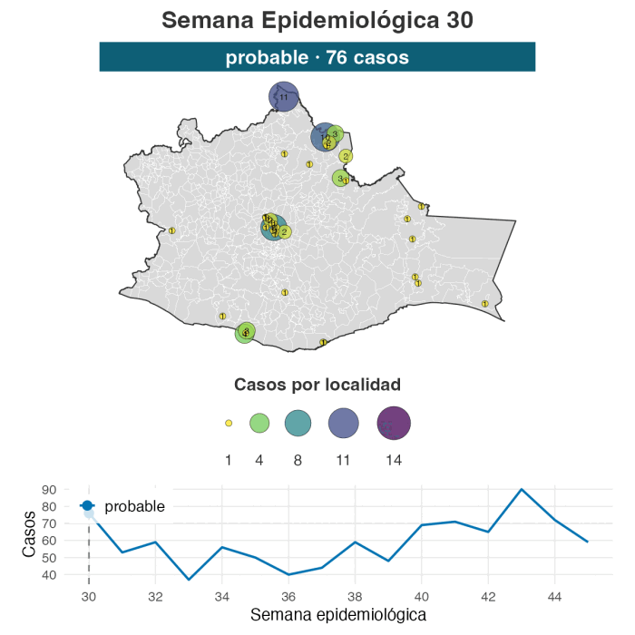
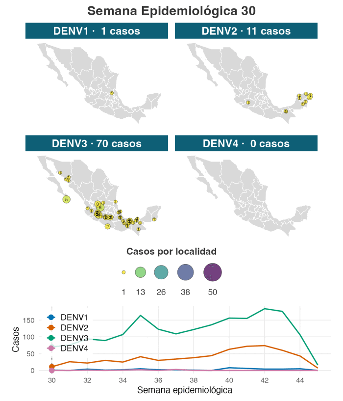
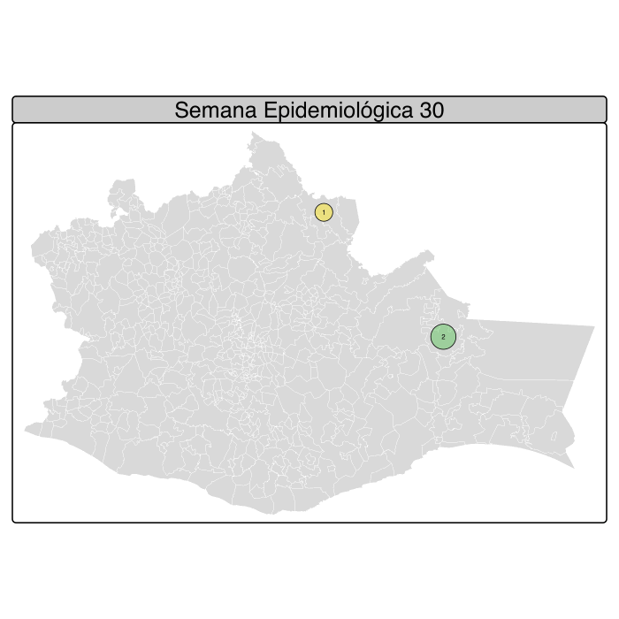

<!-- Precomputed vignette. Edit animated_maps.Rmd.orig (not the .Rmd) and
     rebuild on the computer with the data, from the vignettes/ folder:
     knitr::knit("animated_maps.Rmd.orig", "animated_maps.Rmd")
     The gifs (vignettes/figures/anim-*.gif) are shared with the Spanish
     version; they are made only if they do not exist (delete them to update).
     Only aggregated counts by locality and municipality are published. -->


[Versión en español](mapas_animados.html)

## Introduction

An animated map shows **how transmission moves** week by week: where it starts, where it spreads and when it fades. **densnv** has two functions:


|function          |unit                                 |cases                                                                    |engine                                         |
|:-----------------|:------------------------------------|:------------------------------------------------------------------------|:----------------------------------------------|
|mp_animated_loc() |Locality (proportional circles)      |Probable, confirmed, final diagnosis or serotype; one or several at once |ggplot2 + gifski, with optional epidemic curve |
|mp_animated_mpo() |Municipality (circles or choropleth) |Confirmed (DNG, DCSA and DG)                                             |tmap + gifski                                  |


Titles and labels are in Spanish, the language of the users of the Mexican vector-borne disease program.


``` r
library(densnv)
```

## Data


``` r
path <- "DENGUE2_.txt"
x <- data.table::fread(path, quote = "", fill = TRUE)
```


## By locality: `mp_animated_loc()`

It counts the cases by locality of report and epidemiological week, and draws them as proportional circles over the state (country) or municipal (state) boundaries. The size and colour scales are **the same in every frame**, so the weeks can be compared. With `curve = TRUE` it adds the epidemic curve below, with the current week marked.

### One state: Oaxaca


``` r
mp_animated_loc(path = path,
                snv_dataset = "DENV",
                year = 2026,
                week = 1:52,
                var = "probable",
                multi = "sum",
                country = FALSE,
                cve_edo = "20",
                breaks = NULL,
                pal = "-viridis",
                text_size = 0.4,
                fps = 2,
                curve = TRUE,
                map_legend = TRUE,
                legend_title = "Casos por localidad",
                save = TRUE,
                name = "dengue_oaxaca_2026",
                dir = "./")
```


<div class="figure">

<p class="caption">plot of chunk loc_oaxaca_fig</p>
</div>

### Several types of cases

The `var` argument takes one or several values: `"probable"`, `"confirmado"`, `"DNG"`, `"DCSA"`, `"DG"`, `"DENV1"` to `"DENV4"`. With several, `multi` sets how they are combined:

1. **`multi = "sum"`:** adds them in a single map (e.g. the severe forms, `c("DCSA", "DG")`).
2. **`multi = "facet"`:** one panel per value, with the same scale (e.g. one panel per serotype). A case can appear in more than one panel.


``` r
mp_animated_loc(path = path,
                snv_dataset = "DENV",
                year = 2026,
                week = 1:52,
                var = c("DENV1", "DENV2", "DENV3", "DENV4"),
                multi = "facet",
                ncol = 2,
                country = TRUE,
                cve_edo = NULL,
                curve = TRUE,
                save = TRUE,
                name = "serotypes_mexico_2026",
                dir = "./")
```


<div class="figure">

<p class="caption">plot of chunk loc_serotypes_fig</p>
</div>

## By municipality: `mp_animated_mpo()`

It counts the confirmed cases (non-severe dengue, with warning signs and severe) by municipality of residence and week. With `dot = TRUE` it draws proportional circles; with `dot = FALSE`, a choropleth map with the palette `pal`.


``` r
mp_animated_mpo(data = x,
                year = 2026,
                name = "Oaxaca",
                dir = "./",
                country = FALSE,
                breaks = NULL,
                save = TRUE,
                cve_edo = "20",
                text_size = 0.3,
                dot = TRUE,
                pal = viridis::viridis)
```


<div class="figure">

<p class="caption">plot of chunk mpo_oaxaca_fig</p>
</div>

## Recommendations

1. **Size of the gif:** with 52 weeks and the whole country, the gif can weigh several MB. For presentations use `fps = 2` or `3` and limit `week` to the period of interest.
2. **Comparing weeks:** the scales are the same in every frame, so a circle of the same size means the same number of cases in any week.
3. **Saving:** with `save = TRUE` the gif is saved in `dir`; with `save = FALSE` it is only shown in the RStudio Viewer.
4. The gifs of this vignette show only the last 16 weeks and are reduced in size.

## Notes

1. `mp_animated_loc()` uses the locality of **report** and the INEGI 2020 locality catalogue (`rgeomex::iter_2020_loc`).
2. `mp_animated_mpo()` uses the municipality of **residence** and excludes the cases from other countries.
3. Both functions need the gifski package.
