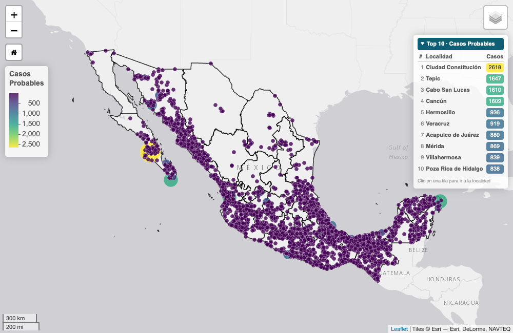
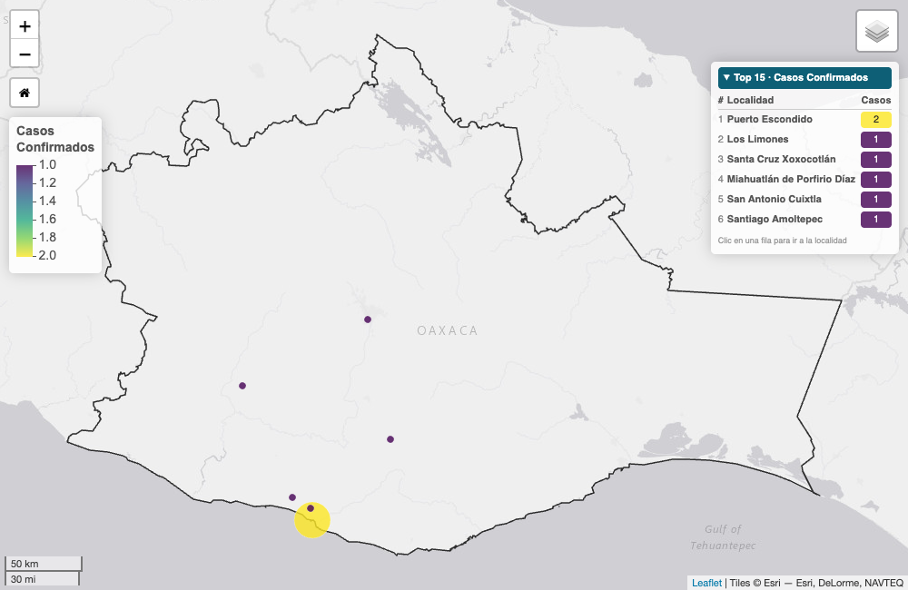

<!-- Precomputed vignette. Edit cases_locality.Rmd.orig (not the .Rmd) and
     rebuild on the computer with the data, from the vignettes/ folder:
     knitr::knit("cases_locality.Rmd.orig", "cases_locality.Rmd")
     Only aggregated counts by locality are published. -->


[Versión en español](casos_localidad.html)

## Introduction

The locality is the operational unit of the dengue program: entomological surveillance, larval control and fogging are scheduled there. **densnv** has two functions to see where the cases are at that level:

1. `cases_by_loc()` reads the SINAVE dataset (dengue, Zika or chikungunya), counts the probable and confirmed cases by **locality of report** and joins them to the INEGI locality catalogue (ITER 2020). It returns one point per locality with cases.
2. `mp_cases_loc()` makes an interactive map (leaflet) with proportional circles, state and municipal boundaries, and a panel with the localities with the most cases. Clicking a row of the panel zooms the map to that locality.

Column names and map labels are in Spanish, the language of the users of the Mexican vector-borne disease program.


``` r
library(densnv)
```

## Cases by locality


``` r
den <- cases_by_loc(path = "DENGUE2_.txt", snv_dataset = "DENV")
```


Only probable and confirmed cases are counted (`ESTATUS_CASO` 1 and 2). The locality key (`cvegeo`, 9 digits) is built from the state, municipality and locality of report. The columns returned are:


|column                    |description                                                                            |
|:-------------------------|:--------------------------------------------------------------------------------------|
|cvegeo                    |INEGI locality key                                                                     |
|nom_ent, nom_mun, nom_loc |Names of the state, municipality and locality (ITER 2020)                              |
|probable                  |Notified cases (probable + confirmed)                                                  |
|confirmado                |Confirmed cases                                                                        |
|DNG, DCSA, DG             |Cases by final diagnosis: non-severe dengue, with warning signs and severe (DENV only) |
|DENV1 to DENV4            |Cases by serotype (DENV only)                                                          |
|altitud                   |Altitude of the locality (m)                                                           |
|pobtot                    |Total population (Census 2020)                                                         |
|geometry                  |Point of the locality (EPSG:4326)                                                      |


Localities with the most probable cases in the country:


``` r
den |>
  sf::st_drop_geometry() |>
  dplyr::arrange(dplyr::desc(probable)) |>
  dplyr::select(nom_ent, nom_loc, probable, confirmado, DCSA, DG) |>
  head(10)
#>                            nom_ent              nom_loc probable confirmado
#> 1              Baja California Sur  Ciudad Constitución     2618        235
#> 2                          Nayarit                Tepic     1647        184
#> 3              Baja California Sur       Cabo San Lucas     1610        234
#> 4                     Quintana Roo               Cancún     1609        285
#> 5                           Sonora           Hermosillo      936        679
#> 6  Veracruz de Ignacio de la Llave             Veracruz      919        115
#> 7                         Guerrero   Acapulco de Juárez      880         20
#> 8                          Yucatán               Mérida      869         41
#> 9                          Tabasco         Villahermosa      839        121
#> 10 Veracruz de Ignacio de la Llave Poza Rica de Hidalgo      838        187
#>    DCSA DG
#> 1   137  7
#> 2   127  9
#> 3   144 15
#> 4    80  4
#> 5   344 22
#> 6    65  3
#> 7    13  0
#> 8    23  1
#> 9    73  0
#> 10   69  1
```

National summary by serotype and severity:


``` r
den |>
  sf::st_drop_geometry() |>
  dplyr::summarise(localities = dplyr::n(),
                   probable = sum(probable),
                   confirmed = sum(confirmado),
                   dplyr::across(c(DNG, DCSA, DG, DENV1, DENV2, DENV3, DENV4), sum))
#>   localities probable confirmed  DNG DCSA  DG DENV1 DENV2 DENV3 DENV4
#> 1       5016    50234     10400 5212 4862 322    47   750  2914    12
```

### Incidence by locality

With the 2020 Census population the incidence per 100,000 inhabitants can be computed. It is better to restrict it to localities with enough population, because in small localities a single case gives a very high incidence:


``` r
den |>
  sf::st_drop_geometry() |>
  dplyr::filter(pobtot >= 10000) |>
  dplyr::mutate(incidence = round(1e5 * probable / pobtot, 1)) |>
  dplyr::arrange(dplyr::desc(incidence)) |>
  dplyr::select(nom_ent, nom_loc, pobtot, probable, incidence) |>
  head(10)
#>                            nom_ent                 nom_loc pobtot probable
#> 1              Baja California Sur     Ciudad Constitución  43805     2618
#> 2                          Sinaloa                Eldorado  14772      136
#> 3                           Sonora            Pueblo Yaqui  14173      122
#> 4              Baja California Sur          Cabo San Lucas 202694     1610
#> 5                          Chiapas              Pichucalco  15244      121
#> 6                          Jalisco                  Cocula  16550      121
#> 7                           Sonora Miguel Alemán (La Doce)  39474      285
#> 8  Veracruz de Ignacio de la Llave                 Oteapan  10343       72
#> 9              Michoacán de Ocampo    Los Reyes de Salgado  49940      300
#> 10 Veracruz de Ignacio de la Llave               Tihuatlán  15305       85
#>    incidence
#> 1     5976.5
#> 2      920.7
#> 3      860.8
#> 4      794.3
#> 5      793.8
#> 6      731.1
#> 7      722.0
#> 8      696.1
#> 9      600.7
#> 10     555.4
```

### By epidemiological week

The `week` argument filters the weeks, for example the last four (active transmission):


``` r
wk <- data.table::fread(path_den, quote = "", fill = TRUE, select = c("ANO", "SEM"))
last4 <- max(wk$SEM[wk$ANO == max(wk$ANO)]) - 3:0
den_4 <- cases_by_loc(path = path_den, snv_dataset = "DENV", week = last4)
den_4 |>
  sf::st_drop_geometry() |>
  dplyr::arrange(dplyr::desc(probable)) |>
  dplyr::select(nom_ent, nom_loc, probable, confirmado) |>
  head(10)
#>                nom_ent             nom_loc probable confirmado
#> 1  Baja California Sur Ciudad Constitución     1328         67
#> 2  Baja California Sur      Cabo San Lucas      467         81
#> 3               Sonora          Hermosillo      450        243
#> 4         Quintana Roo              Cancún      427         86
#> 5              Nayarit               Tepic      326         46
#> 6  Baja California Sur              La Paz      254         13
#> 7               Sonora     Heroica Caborca      221         12
#> 8       Aguascalientes      Aguascalientes      153        128
#> 9  Baja California Sur   San José del Cabo      151         22
#> 10 Baja California Sur  Ciudad Insurgentes      125          0
```

### Zika and chikungunya


``` r
zik  <- cases_by_loc(path = "ZIKA2_.txt",        snv_dataset = "ZIKV")
chik <- cases_by_loc(path = "CHIKUNGUNYA2_.txt", snv_dataset = "CHIKV")
```


``` r
lapply(list(dengue = den, zika = zik, chikungunya = chik), function(x){
  if(is.null(x)) return(NULL)
  x <- sf::st_drop_geometry(x)
  c(localities = nrow(x), probable = sum(x$probable), confirmed = sum(x$confirmado))
})
#> $dengue
#> localities   probable  confirmed 
#>       5016      50234      10400 
#> 
#> $zika
#> NULL
#> 
#> $chikungunya
#> NULL
```

## Interactive map


``` r
mp_cases_loc(data = den,
             var = "probable",
             top_n = 10,
             title = "Casos Probables",
             palette = "D",
             r_min = 4,
             r_max = 20,
             cve_edo = NULL,
             mun_boundaries = TRUE,
             edo_boundaries = TRUE,
             table_position = "topright")
```

<div class="figure">

<p class="caption">plot of chunk map_country_fig</p>
</div>

One state (Oaxaca), confirmed cases in the last four weeks:


``` r
mp_cases_loc(data = den_4,
             var = "confirmado",
             top_n = 15,
             title = "Casos Confirmados",
             palette = "D",
             r_min = 4,
             r_max = 20,
             cve_edo = "20",
             mun_boundaries = TRUE,
             edo_boundaries = TRUE,
             table_position = "topright")
```

<div class="figure">

<p class="caption">plot of chunk map_oaxaca_fig</p>
</div>

`var` accepts any count column: `"probable"`, `"confirmado"`, `"DNG"`, `"DCSA"`, `"DG"` or a serotype (`"DENV1"`...). In the interactive map the boundaries are turned on and off in the layers control, the home button returns to the state or the country, and hovering over a municipality shows its name.

## Notes

1. The locality is the locality of **report**, not of residence: in non-endemic areas the cases are reported in the place of exposure.
2. Records with empty keys (`"00"`, `"000"`, `"0000"`) and localities not in ITER 2020 are dropped.
3. Incidence in small localities is unstable; use a population threshold.
