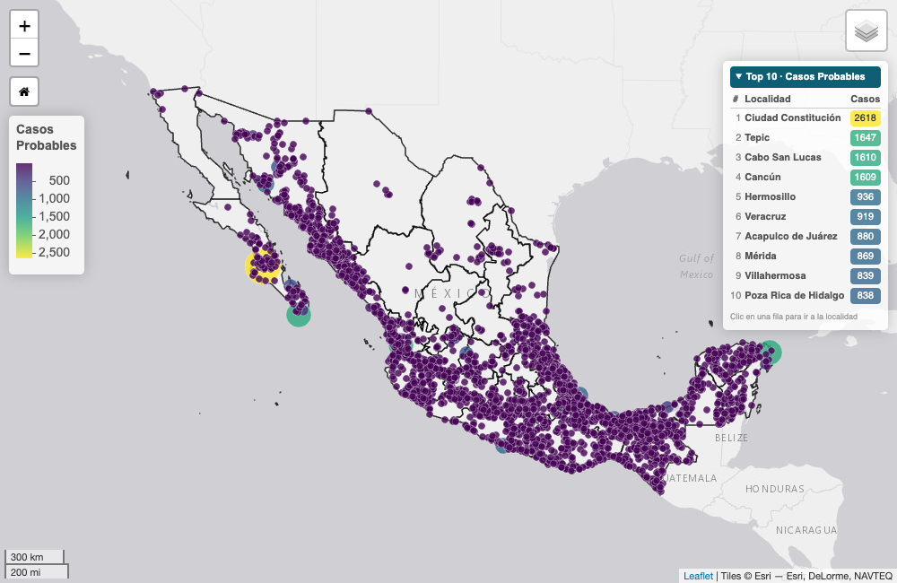
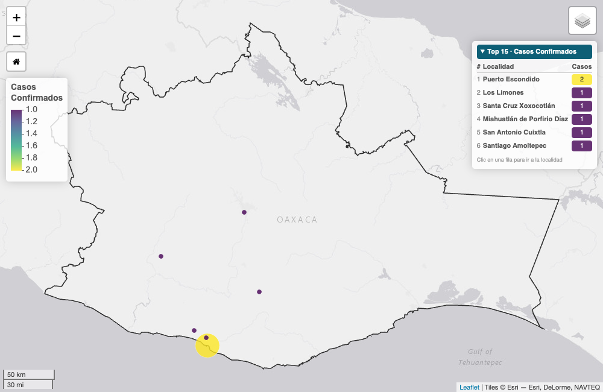

<!-- Vignette precalculado. Editar casos_localidad.Rmd.orig (no el .Rmd) y
     regenerar en la computadora con los datos, desde la carpeta vignettes/:
     knitr::knit("casos_localidad.Rmd.orig", "casos_localidad.Rmd")
     Solo se publican conteos agregados por localidad. -->


[English version](cases_locality.html)

## Introducción

La localidad es la unidad operativa del programa de dengue: ahí se programan la vigilancia entomológica, el control larvario y la nebulización. **densnv** tiene dos funciones para ver dónde están los casos a ese nivel:

1. `cases_by_loc()` lee la base del SINAVE (dengue, Zika o chikungunya), cuenta los casos probables y confirmados por **localidad de reporte** y los une al catálogo de localidades del INEGI (ITER 2020). Regresa un punto por localidad con casos.
2. `mp_cases_loc()` hace un mapa interactivo (leaflet) con círculos proporcionales, límites estatales y municipales, y un panel con las localidades con más casos. Al hacer clic en un renglón del panel, el mapa se acerca a esa localidad.


``` r
library(densnv)
```

## Casos por localidad


``` r
den <- cases_by_loc(path = "DENGUE2_.txt", snv_dataset = "DENV")
```


Se cuentan solo los casos probables y confirmados (`ESTATUS_CASO` 1 y 2). La clave de la localidad (`cvegeo`, 9 dígitos) se arma con el estado, municipio y localidad de reporte. Las columnas que regresa son:


|columna                   |descripción                                                                            |
|:-------------------------|:--------------------------------------------------------------------------------------|
|cvegeo                    |Clave INEGI de la localidad                                                            |
|nom_ent, nom_mun, nom_loc |Nombres del estado, municipio y localidad (ITER 2020)                                  |
|probable                  |Casos notificados (probables + confirmados)                                            |
|confirmado                |Casos confirmados                                                                      |
|DNG, DCSA, DG             |Casos por diagnóstico final: dengue no grave, con signos de alarma y grave (solo DENV) |
|DENV1 a DENV4             |Casos por serotipo (solo DENV)                                                         |
|altitud                   |Altitud de la localidad (m)                                                            |
|pobtot                    |Población total (Censo 2020)                                                           |
|geometry                  |Punto de la localidad (EPSG:4326)                                                      |


Localidades con más casos probables en el país:


``` r
den |>
  sf::st_drop_geometry() |>
  dplyr::arrange(dplyr::desc(probable)) |>
  dplyr::select(nom_ent, nom_loc, probable, confirmado, DCSA, DG) |>
  head(10)
#>                            nom_ent              nom_loc probable confirmado
#> 1              Baja California Sur  Ciudad Constitución     2618        235
#> 2                          Nayarit                Tepic     1647        184
#> 3              Baja California Sur       Cabo San Lucas     1610        234
#> 4                     Quintana Roo               Cancún     1609        285
#> 5                           Sonora           Hermosillo      936        679
#> 6  Veracruz de Ignacio de la Llave             Veracruz      919        115
#> 7                         Guerrero   Acapulco de Juárez      880         20
#> 8                          Yucatán               Mérida      869         41
#> 9                          Tabasco         Villahermosa      839        121
#> 10 Veracruz de Ignacio de la Llave Poza Rica de Hidalgo      838        187
#>    DCSA DG
#> 1   137  7
#> 2   127  9
#> 3   144 15
#> 4    80  4
#> 5   344 22
#> 6    65  3
#> 7    13  0
#> 8    23  1
#> 9    73  0
#> 10   69  1
```

Resumen nacional por serotipo y gravedad:


``` r
den |>
  sf::st_drop_geometry() |>
  dplyr::summarise(localidades = dplyr::n(),
                   probables = sum(probable),
                   confirmados = sum(confirmado),
                   dplyr::across(c(DNG, DCSA, DG, DENV1, DENV2, DENV3, DENV4), sum))
#>   localidades probables confirmados  DNG DCSA  DG DENV1 DENV2 DENV3 DENV4
#> 1        5016     50234       10400 5212 4862 322    47   750  2914    12
```

### Incidencia por localidad

Con la población del Censo 2020 se calcula la incidencia por 100 mil habitantes. Conviene limitarla a localidades con suficiente población, porque en localidades pequeñas un solo caso da una incidencia muy alta:


``` r
den |>
  sf::st_drop_geometry() |>
  dplyr::filter(pobtot >= 10000) |>
  dplyr::mutate(incidencia = round(1e5 * probable / pobtot, 1)) |>
  dplyr::arrange(dplyr::desc(incidencia)) |>
  dplyr::select(nom_ent, nom_loc, pobtot, probable, incidencia) |>
  head(10)
#>                            nom_ent                 nom_loc pobtot probable
#> 1              Baja California Sur     Ciudad Constitución  43805     2618
#> 2                          Sinaloa                Eldorado  14772      136
#> 3                           Sonora            Pueblo Yaqui  14173      122
#> 4              Baja California Sur          Cabo San Lucas 202694     1610
#> 5                          Chiapas              Pichucalco  15244      121
#> 6                          Jalisco                  Cocula  16550      121
#> 7                           Sonora Miguel Alemán (La Doce)  39474      285
#> 8  Veracruz de Ignacio de la Llave                 Oteapan  10343       72
#> 9              Michoacán de Ocampo    Los Reyes de Salgado  49940      300
#> 10 Veracruz de Ignacio de la Llave               Tihuatlán  15305       85
#>    incidencia
#> 1      5976.5
#> 2       920.7
#> 3       860.8
#> 4       794.3
#> 5       793.8
#> 6       731.1
#> 7       722.0
#> 8       696.1
#> 9       600.7
#> 10      555.4
```

### Por semana epidemiológica

El argumento `week` filtra las semanas, por ejemplo las últimas cuatro (transmisión activa):


``` r
sem <- data.table::fread(ruta_den, quote = "", fill = TRUE, select = c("ANO", "SEM"))
ultimas <- max(sem$SEM[sem$ANO == max(sem$ANO)]) - 3:0
den_4 <- cases_by_loc(path = ruta_den, snv_dataset = "DENV", week = ultimas)
den_4 |>
  sf::st_drop_geometry() |>
  dplyr::arrange(dplyr::desc(probable)) |>
  dplyr::select(nom_ent, nom_loc, probable, confirmado) |>
  head(10)
#>                nom_ent             nom_loc probable confirmado
#> 1  Baja California Sur Ciudad Constitución     1328         67
#> 2  Baja California Sur      Cabo San Lucas      467         81
#> 3               Sonora          Hermosillo      450        243
#> 4         Quintana Roo              Cancún      427         86
#> 5              Nayarit               Tepic      326         46
#> 6  Baja California Sur              La Paz      254         13
#> 7               Sonora     Heroica Caborca      221         12
#> 8       Aguascalientes      Aguascalientes      153        128
#> 9  Baja California Sur   San José del Cabo      151         22
#> 10 Baja California Sur  Ciudad Insurgentes      125          0
```

### Zika y chikungunya


``` r
zik  <- cases_by_loc(path = "ZIKA2_.txt",        snv_dataset = "ZIKV")
chik <- cases_by_loc(path = "CHIKUNGUNYA2_.txt", snv_dataset = "CHIKV")
```


``` r
lapply(list(dengue = den, zika = zik, chikungunya = chik), function(x){
  if(is.null(x)) return(NULL)
  x <- sf::st_drop_geometry(x)
  c(localidades = nrow(x), probables = sum(x$probable), confirmados = sum(x$confirmado))
})
#> $dengue
#> localidades   probables confirmados 
#>        5016       50234       10400 
#> 
#> $zika
#> NULL
#> 
#> $chikungunya
#> NULL
```

## Mapa interactivo


``` r
mp_cases_loc(data = den,
             var = "probable",
             top_n = 10,
             title = "Casos Probables",
             palette = "D",
             r_min = 4,
             r_max = 20,
             cve_edo = NULL,
             mun_boundaries = TRUE,
             edo_boundaries = TRUE,
             table_position = "topright")
```

<div class="figure">

<p class="caption">plot of chunk mapa_pais_fig</p>
</div>

Un estado (Oaxaca), casos confirmados en las últimas cuatro semanas:


``` r
mp_cases_loc(data = den_4,
             var = "confirmado",
             top_n = 15,
             title = "Casos Confirmados",
             palette = "D",
             r_min = 4,
             r_max = 20,
             cve_edo = "20",
             mun_boundaries = TRUE,
             edo_boundaries = TRUE,
             table_position = "topright")
```

<div class="figure">

<p class="caption">plot of chunk mapa_oaxaca_fig</p>
</div>

`var` acepta cualquier columna de conteo: `"probable"`, `"confirmado"`, `"DNG"`, `"DCSA"`, `"DG"` o un serotipo (`"DENV1"`...). En el mapa interactivo, los límites se prenden y apagan en el control de capas, el botón de inicio regresa al estado o al país, y al pasar el cursor sobre un municipio aparece su nombre.

## Notas

1. La localidad es la de **reporte**, no la de residencia: en áreas no endémicas los casos se reportan en el lugar de exposición.
2. Se descartan los registros con claves vacías (`"00"`, `"000"`, `"0000"`) y las localidades que no están en el ITER 2020.
3. La incidencia en localidades pequeñas es inestable; conviene usar un umbral de población.
