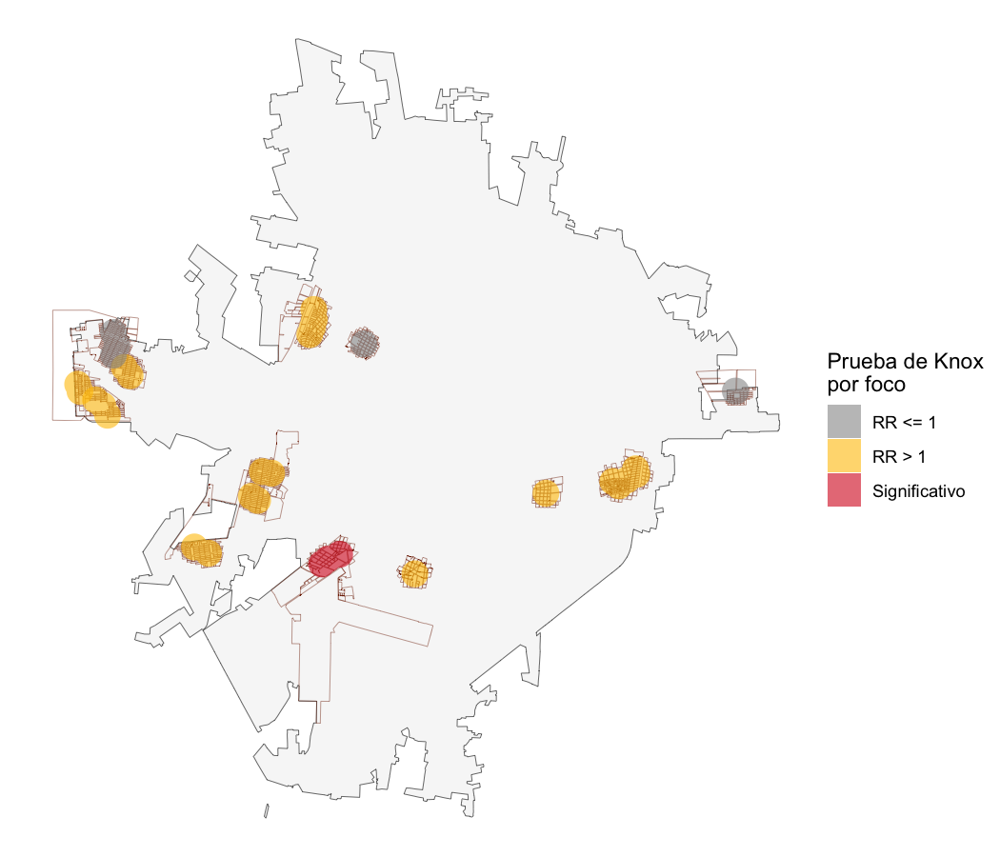
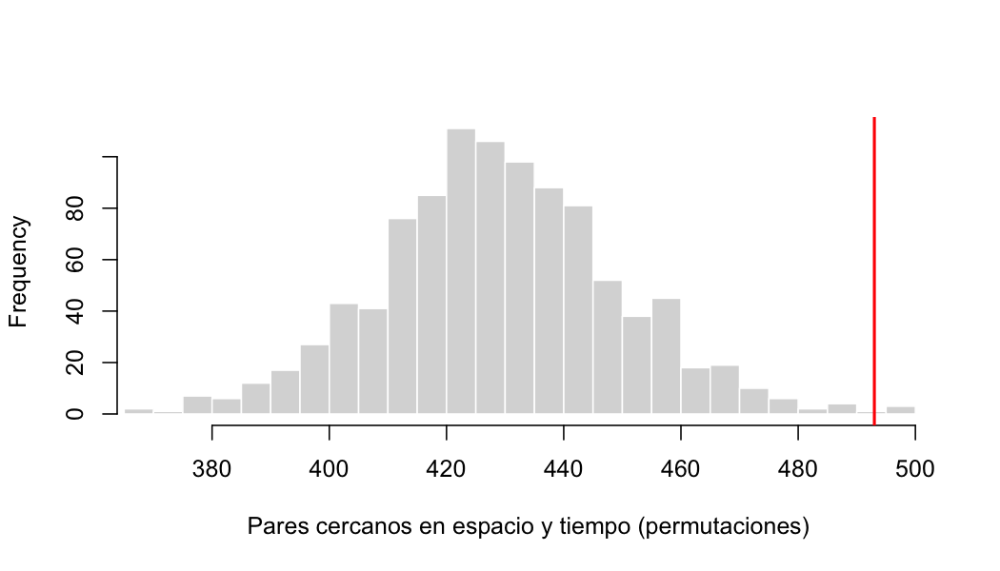
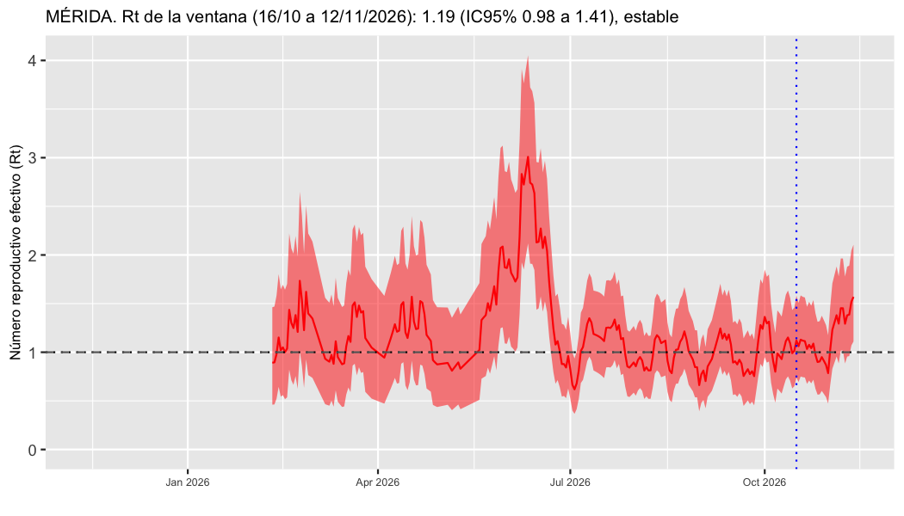

<!-- Vignette precalculado. Editar focos_activos.Rmd.orig (no el .Rmd) y regenerar
     en la computadora con los datos, desde la carpeta vignettes/:
     knitr::knit("focos_activos.Rmd.orig", "focos_activos.Rmd")
     CONFIDENCIALIDAD: no imprimir res$cases, coordenadas ni mapas con los casos. -->


[English version](active_foci.html)

## Introducción

Un **foco de transmisión activa** es un grupo de casos de dengue cercanos en el espacio y en el tiempo, que indica que el virus está circulando ahora en un área delimitada. Identificarlo permite dirigir el control vectorial a las manzanas donde la transmisión está ocurriendo, en lugar de a toda la ciudad.

La función `mp_active_foci()` del paquete **densnv**:

1. Identifica los focos activos con DBSCAN espacio-temporal.
2. Delimita la zona de transmisión y la zona de control, y selecciona las manzanas a intervenir.
3. Evalúa si los casos están más agrupados en espacio y tiempo de lo esperado por azar (prueba de Knox).
4. Estima el número reproductivo efectivo (Rt) de la localidad con `rt_dengue()`.
5. Diagnostica el escenario epidemiológico y propone la estrategia operativa.
6. Regresa un mapa interactivo con los focos, las zonas, las manzanas y los casos.


``` r
library(densnv)
```

## Datos

La función usa la base de dengue del SINAVE con los casos **geocodificados**. Las columnas necesarias son:


|columna                               |uso                                              |
|:-------------------------------------|:------------------------------------------------|
|long, lat                             |Coordenadas del domicilio (EPSG:4326)            |
|ESTATUS_CASO                          |Estatus del caso: 1 probable, 2 confirmado       |
|FEC_INI_SIGNOS_SINT                   |Fecha de inicio de síntomas                      |
|CVE_EDO_REP, CVE_MPO_REP, CVE_LOC_REP |Localidad de reporte, para el Rt (place = "REP") |


``` r
load("dengue_mx_2026.RData")
```


## Parámetros y su justificación


|argumento      |defecto  |justificación                                                                                                     |
|:--------------|:--------|:-----------------------------------------------------------------------------------------------------------------|
|spatial_scale  |400      |Rango de vuelo de Aedes aegypti (metros)                                                                          |
|temporal_scale |21       |Periodo de incubación intrínseco + extrínseco (días); el programa usa 28 días (4 semanas) como transmisión activa |
|min_cases      |3        |Casos mínimos en la vecindad espacio-temporal para formar un foco                                                 |
|buffer_m       |200      |Amortiguamiento alrededor de la zona de transmisión para el control (100 m equivalen a una manzana)               |
|method         |"window" |"window": solo los casos de la ventana; "st-dbscan": cadenas de transmisión, focos nuevos y persistentes          |
|perm_days      |365      |Días de casos para la prueba de Knox, el Rt y ST-DBSCAN                                                           |
|n_sim          |999      |Permutaciones de la prueba de Knox                                                                                |


Las distancias se calculan en metros con la proyección **México ITRF2008 / LCC (EPSG:6372)**, que tiene un error de escala menor a 1% en todo el país.

## Cómo funciona

1. **Localidad:** se extrae el polígono de la localidad con `rgeomex::extract_locality()` y se recortan los casos.
2. **Ventana espacial y temporal:** la ventana son los `temporal_scale` días hasta `ref_date` (por defecto, el último inicio de síntomas).
3. **DBSCAN** (paquete [dbscan](https://doi.org/10.18637/jss.v091.i01)): un caso es *núcleo* si tiene al menos `min_cases` casos (incluido él mismo) a `spatial_scale` metros o menos y, con ST-DBSCAN, a `temporal_scale` días o menos. Los núcleos vecinos forman el mismo foco. Un foco es **activo** si tiene al menos un caso en la ventana.
4. **Zonas:** la zona de transmisión es la unión de círculos de `spatial_scale` metros alrededor de los casos recientes del foco; la zona de control le suma `buffer_m` metros. Se seleccionan las manzanas (INE 2020) que tocan la zona de control.
5. **Prueba de Knox, Rt y diagnóstico** (secciones siguientes).
6. **Mapa** interactivo (mapgl), con mapas base y capas en un control desplegable.

## Ejemplo: Mérida


``` r
res <- mp_active_foci(geocoded_dataset = z,
                      cve_edo = "31",
                      locality = "Merida",
                      status_caso = c(1, 2),
                      spatial_scale = 400,
                      temporal_scale = 28,
                      min_cases = 3,
                      buffer_m = 0,
                      ref_date = NULL,
                      method = "st-dbscan",
                      n_sim = 999,
                      perm_days = 365,
                      alpha = 0.05,
                      seed = 123,
                      place = "REP",
                      mean_si = 21,
                      std_si = 6.1,
                      capacity_cases = NULL,
                      coverage_min = NULL,
                      foci_min = 0.9,
                      print_map = FALSE,
                      save = FALSE,
                      dir = "./")
```

La función regresa una lista con el mapa interactivo (`res$map`), los focos (`res$foci`), las zonas de transmisión (`res$transmission`), las manzanas a controlar (`res$blocks`), los casos (`res$cases`), la prueba de Knox (`res$knox`) y el diagnóstico (`res$diagnostico`).

Resumen de los focos activos:


``` r
sf::st_drop_geometry(res$foci)[, c("foco", "tipo", "casos", "casos_recientes",
                                   "duracion_dias", "area_transmision_km2",
                                   "manzanas")]
#> # A tibble: 13 × 7
#>     foco tipo        casos casos_recientes duracion_dias area_transmision_km2
#>    <int> <chr>       <int>           <int>         <dbl>                <dbl>
#>  1     1 Persistente    35               5           172                 1.4 
#>  2     2 Persistente     8               3            78                 0.98
#>  3     3 Persistente     9               2            59                 0.85
#>  4     4 Persistente     3               1            21                 0.5 
#>  5     5 Persistente     8               5            36                 1.28
#>  6     6 Persistente     5               3            22                 0.5 
#>  7     7 Persistente     4               2            14                 0.51
#>  8     8 Persistente     3               2            23                 0.68
#>  9     9 Persistente     3               2            15                 0.74
#> 10    10 Persistente     3               2            19                 0.5 
#> 11    11 Nuevo           3               3            25                 0.97
#> 12    12 Nuevo           3               3             8                 1.04
#> 13    13 Nuevo           4               4            16                 1.1 
#> # ℹ 1 more variable: manzanas <int>
```

Zonas de transmisión y manzanas a controlar (por confidencialidad, la figura no muestra los casos):

<div class="figure">

<p class="caption">plot of chunk mapa_zonas</p>
</div>

## Prueba de Knox

¿Los focos son reales o podrían aparecer por azar? La **prueba de Knox** cuenta los **pares de casos** que están cerca en espacio (≤ `spatial_scale`) y en tiempo (≤ `temporal_scale`), la misma ventana que define los focos. Para saber cuántos pares esperar por azar, se **permutan las fechas** de inicio entre los casos del periodo: las ubicaciones se quedan fijas (respeta la distribución de la población) y la curva epidémica se conserva.

1. **RR** = pares observados / pares esperados. RR = 1.13 indica 13% más pares cercanos de lo esperado.
2. **Valor p** = (1 + permutaciones con tantos pares o más) / (`n_sim` + 1).
3. **Knox global:** todos los pares de la localidad. Es la prueba formal.
4. **Knox por foco:** solo los pares dentro de la zona de transmisión de cada foco, con ajuste de Holm. Como los focos se eligieron por estar cerca en espacio y tiempo, estos valores p son optimistas: sirven para **priorizar** los focos, no como prueba formal.

En el mapa, la zona de transmisión se colorea según la prueba por foco: **rojo**, significativo (p de Holm < `alpha`); **amarillo**, exceso no significativo (RR > 1); **gris**, sin exceso (RR ≤ 1).


``` r
res$knox[c("n_casos", "pares_espacio", "knox", "esperados", "rr", "p_value")]
#> $n_casos
#> [1] 960
#> 
#> $pares_espacio
#> [1] 2302
#> 
#> $knox
#> [1] 493
#> 
#> $esperados
#> [1] 429.5716
#> 
#> $rr
#> [1] 1.147655
#> 
#> $p_value
#> [1] 0.005
sf::st_drop_geometry(res$foci)[, c("foco", "knox_pares", "knox_esperados",
                                   "knox_rr", "p_value", "p_holm", "significativo")]
#> # A tibble: 13 × 7
#>     foco knox_pares knox_esperados knox_rr p_value p_holm significativo
#>    <int>      <dbl>          <dbl>   <dbl>   <dbl>  <dbl> <lgl>        
#>  1     1         40          36.8     1.09   0.295  1     FALSE        
#>  2     2         10           3.52    2.84   0.003  0.039 TRUE         
#>  3     3         16          14.0     1.15   0.295  1     FALSE        
#>  4     4          5           6.75    0.74   0.829  1     FALSE        
#>  5     5         14           8.45    1.66   0.053  0.636 FALSE        
#>  6     6         12           8.45    1.42   0.139  1     FALSE        
#>  7     7          6           6.37    0.94   0.594  1     FALSE        
#>  8     8          3           1.16    2.58   0.115  1     FALSE        
#>  9     9          7           5.04    1.39   0.215  1     FALSE        
#> 10    10          3           1.18    2.55   0.124  1     FALSE        
#> 11    11          2           1.88    1.07   0.547  1     FALSE        
#> 12    12          7           7.47    0.94   0.609  1     FALSE        
#> 13    13          9           5.46    1.65   0.107  1     FALSE
```

Distribución de los pares bajo la hipótesis nula (fechas permutadas) y valor observado (línea roja):


``` r
hist(res$knox$sim, breaks = 30, main = "", col = "gray85", border = "white",
     xlab = "Pares cercanos en espacio y tiempo (permutaciones)",
     xlim = range(c(res$knox$sim, res$knox$knox)))
abline(v = res$knox$knox, col = "red", lwd = 2)
```

<div class="figure">

<p class="caption">plot of chunk knox_hist</p>
</div>

Con muchos casos, hasta un exceso pequeño sale significativo; por eso conviene leer el **RR** (tamaño del efecto) además del valor p.

## Número reproductivo efectivo (Rt)

El Rt de la localidad se estima con `rt_dengue()` (paquete [EpiEstim](https://CRAN.R-project.org/package=EpiEstim), intervalo serial gamma con media `mean_si` = 21 días y desviación estándar `std_si` = 6.1). Se usan **todos los casos reportados en la localidad** (`place = "REP"`), geocodificados o no. En localidades no endémicas, los casos se reportan en el lugar de exposición, por eso se usa el lugar de reporte y no el de residencia.

La **fase del brote** se define con el intervalo de credibilidad del 95% del Rt de la ventana:

1. **En ascenso:** límite inferior > 1.
2. **Estable:** el intervalo incluye 1.
3. **En descenso:** límite superior < 1.


``` r
res$diagnostico$rt_plot
```

<div class="figure">

<p class="caption">plot of chunk rt</p>
</div>

La curva usa ventanas semanales móviles con al menos 10 casos, y empieza `mean_si` + 2 `std_si` días después del inicio de la base: antes no hay historia de casos y el Rt se sobreestima. ¿Por qué una ventana? Los conteos diarios son muy variables; la ventana junta los casos de varios días y supone el Rt constante en ella. Una ventana corta detecta antes los cambios pero es ruidosa; una larga es más precisa pero tarda en mostrar un cambio de fase.

## Diagnóstico del escenario epidemiológico

De acuerdo con expertos en brotes de dengue, la transmisión pasa de focalizada a **generalizada** cuando hay:

1. **Incremento sostenido y significativo:** los casos de la ventana están significativamente por arriba de la media por ventana del periodo (prueba de Poisson), la ventana previa también, y el Rt de la ventana es mayor que 1.
2. **Casos que rebasan la capacidad operativa:** los casos por semana son más que `capacity_cases` (casos que las brigadas pueden trabajar por semana: la casa del caso y las de alrededor). Es información local que proporciona el programa; con `NULL` no se evalúa.
3. **Casos dispersos en la localidad:** los círculos de `spatial_scale` metros alrededor de los casos recientes cubren `coverage_min` o más de la localidad (por defecto 40% con 21 días y 50% con 28 días), o `foci_min` (90%) o más de los casos recientes están en focos.

La transmisión es generalizada con el criterio 1 y, además, el 2 o el 3.


|escenario                                  |criterio                                       |acción                                                                          |
|:------------------------------------------|:----------------------------------------------|:-------------------------------------------------------------------------------|
|Transmisión generalizada                   |Incremento y (dispersión o capacidad rebasada) |Barrido; operativo integral (megaoperativo) si se rebasa la capacidad operativa |
|Transmisión focalizada                     |50% o más de los casos recientes en focos      |Estrategia focalizada, priorizando los focos significativos                     |
|Transmisión focalizada con casos dispersos |Menos de 50% de los casos recientes en focos   |Estrategia focalizada y control alrededor de los casos aislados                 |
|Sin focos activos                          |Ningún foco activo                             |Vigilancia entomológica y control alrededor de los casos                        |
|Casos insuficientes                        |Menos de 50 casos en el periodo                |Vigilancia                                                                      |


Si hay incremento significativo con Rt **en ascenso** pero la transmisión no es generalizada, la acción empieza con **alerta temprana**.


``` r
res$diagnostico$escenario
#> [1] "Transmisión focalizada con casos dispersos"
res$diagnostico$detalle
#> [1] "Incremento: 130 casos en la ventana actual y 104 en la previa; media por ventana de 28 días en el periodo: 66 (razón 1.97, p = 2.3e-12); Rt de la ventana actual: 1.19 (IC95% 0.98 a 1.41), estable. Sostenido y significativo."
#> [2] "Capacidad operativa: 32.5 casos por semana a trabajar (capacidad no indicada)."                                                                                                                                                 
#> [3] "Dispersión: los casos recientes (a 400 m) cubren 20% de la localidad (umbral 50%); casos recientes en focos: 28% (umbral 90%). No dispersos en toda la localidad."                                                              
#> [4] "Interacción espacio-temporal (Knox): Sí (RR = 1.15, p = 0.005)."
res$diagnostico$accion
#> [1] "Estrategia focalizada en las zonas de control: nebulización con máquina pesada (3 a 4 aplicaciones, una por semana), control larvario (cobertura > 85%, ICP < 3%) y termonebulización (casos de las últimas 2 semanas); priorizar los focos significativos (rojos). Además, control alrededor de los casos aislados."
```

## Escenarios contrastantes

La misma función, en tres localidades y varias fechas:


``` r
corridas <- data.frame(cve_edo  = c("31", "31", "30", "30", "30"),
                       locality = c("Merida", "Ticul", "Coatzacoalcos",
                                    "Coatzacoalcos", "Coatzacoalcos"),
                       ref_date = c(NA, "2026-10-15", "2026-08-15",
                                    "2026-09-15", "2026-10-15"))
filas <- list()
for(k in seq_len(nrow(corridas))){
  r <- tryCatch(suppressMessages(
    mp_active_foci(geocoded_dataset = z,
                   cve_edo = corridas$cve_edo[k],
                   locality = corridas$locality[k],
                   status_caso = c(1, 2),
                   spatial_scale = 400,
                   temporal_scale = 28,
                   min_cases = 3,
                   buffer_m = 0,
                   ref_date = if(is.na(corridas$ref_date[k])) NULL else corridas$ref_date[k],
                   method = "st-dbscan",
                   n_sim = 999,
                   perm_days = 365,
                   alpha = 0.05,
                   seed = 123,
                   place = "REP",
                   mean_si = 21,
                   std_si = 6.1,
                   capacity_cases = NULL,
                   coverage_min = NULL,
                   foci_min = 0.9,
                   print_map = FALSE,
                   save = FALSE,
                   dir = "./")),
    error = function(e) NULL)
  if(!is.null(r)) filas[[length(filas) + 1]] <- r$diagnostico$tabla
}
tabla <- do.call(rbind, filas)
tabla[, c("localidad", "ref_date", "rt", "fase", "cobertura_casos",
          "pct_casos_en_focos", "knox_rr", "escenario", "alerta_temprana")]
#>       localidad   ref_date   rt       fase cobertura_casos pct_casos_en_focos
#> 1        Merida 2026-11-12 1.19    Estable            20.2                 28
#> 2         Ticul 2026-10-15 3.04 En ascenso            77.0                 88
#> 3 Coatzacoalcos 2026-08-15 1.39 En ascenso            34.6                 64
#> 4 Coatzacoalcos 2026-09-15 1.29 En ascenso            40.6                 73
#> 5 Coatzacoalcos 2026-10-15 1.37 En ascenso            63.9                 76
#>   knox_rr                                  escenario alerta_temprana
#> 1    1.15 Transmisión focalizada con casos dispersos           FALSE
#> 2    1.04                   Transmisión generalizada           FALSE
#> 3    1.27                     Transmisión focalizada            TRUE
#> 4    1.18                     Transmisión focalizada            TRUE
#> 5    1.11                   Transmisión generalizada           FALSE
```

1. **Mérida:** transmisión focalizada con casos dispersos; la prueba de Knox indica cadenas locales de transmisión.
2. **Ticul:** brote explosivo concentrado en pocas semanas; los casos cubren la mayor parte de la localidad. Corresponde un barrido de toda la localidad.
3. **Coatzacoalcos:** la alerta temprana aparece en agosto y septiembre, antes de que la transmisión se generalice en octubre.

## Limitaciones

1. Los umbrales del diagnóstico (50 casos, 40-50% de cobertura, 90% de casos en focos, 50% para focalizada) son reglas prácticas calibradas con 71 localidades en 2026; conviene revisarlos con más años y regiones.
2. El incremento se compara con la media del último año, no con el canal endémico (media histórica), porque no se cuenta con la base histórica.
3. Los últimos días de la base están incompletos por el retraso de notificación, lo que baja el Rt de la ventana.
4. La prueba de Knox por foco es optimista (ver arriba); la prueba formal es la global.
5. La capacidad operativa es información local que debe proporcionar el programa.

## Referencias

1. Hahsler M, Piekenbrock M, Doran D (2019). dbscan: Fast Density-Based Clustering with R. *Journal of Statistical Software*, 91(1), 1-30. <https://doi.org/10.18637/jss.v091.i01>
2. Knox EG (1964). The detection of space-time interactions. *Journal of the Royal Statistical Society, Series C*, 13(1), 25-30.
3. Kulldorff M, Hjalmars U (1999). The Knox method and other tests for space-time interaction. *Biometrics*, 55(2), 544-552.
4. Cori A, Ferguson NM, Fraser C, Cauchemez S (2013). A new framework and software to estimate time-varying reproduction numbers during epidemics. *American Journal of Epidemiology*, 178(9), 1505-1512.
