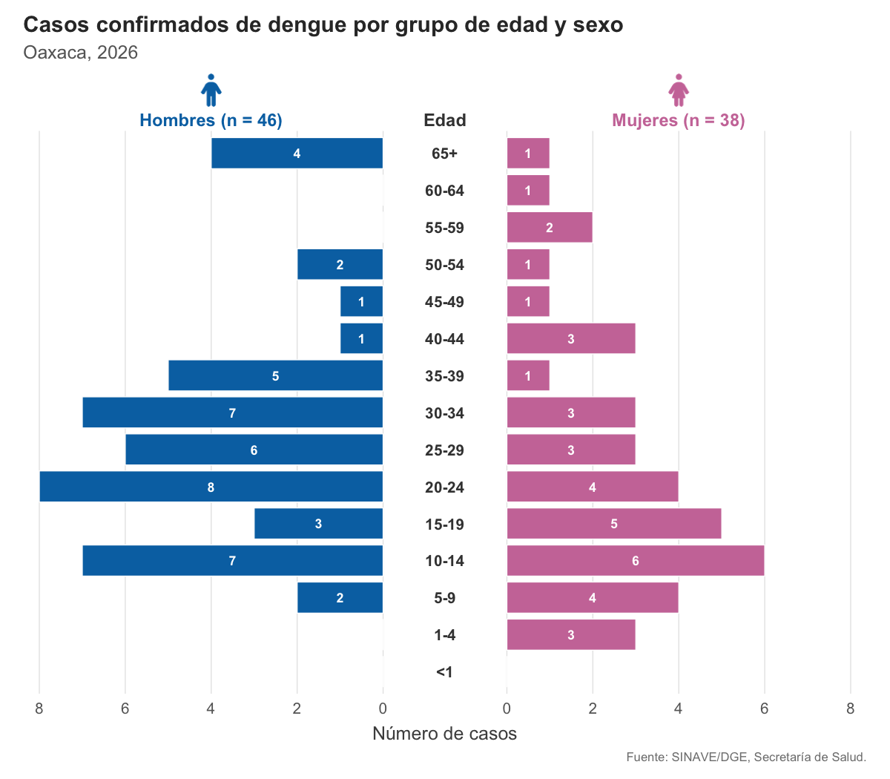
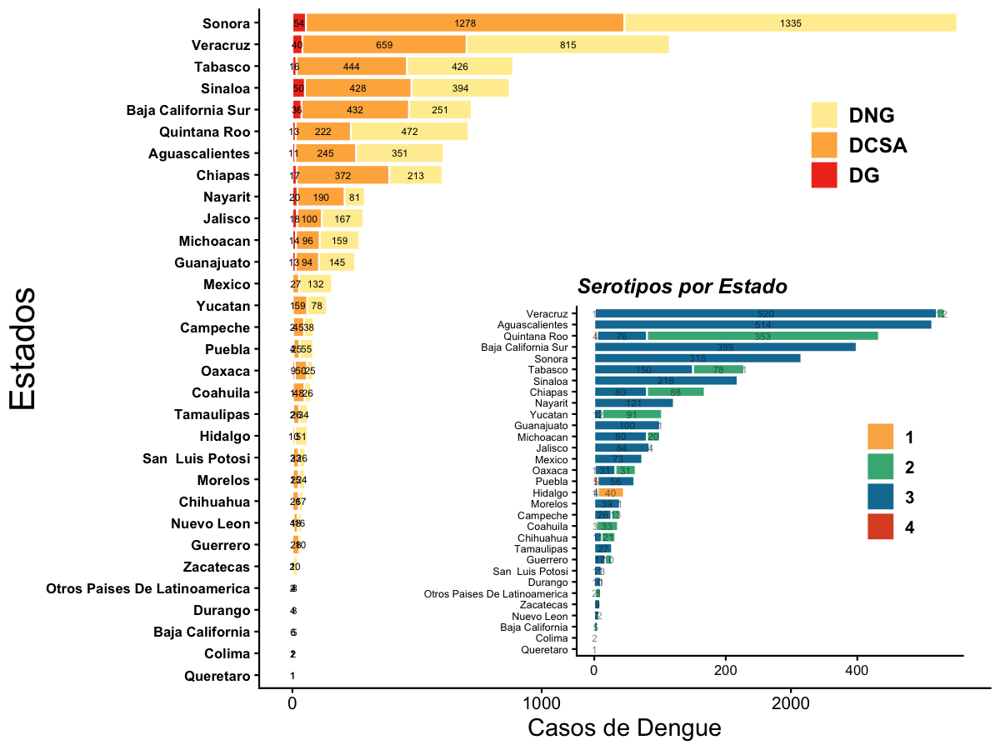
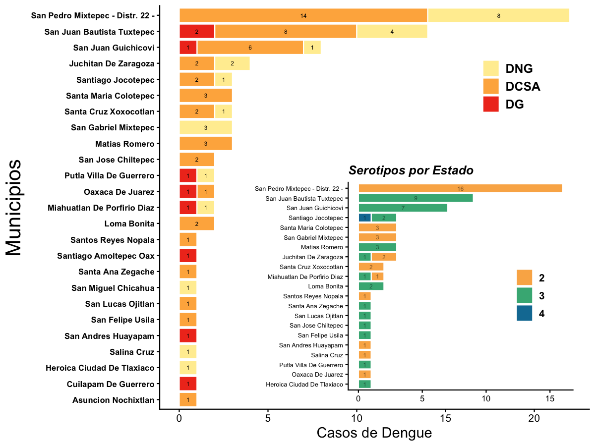
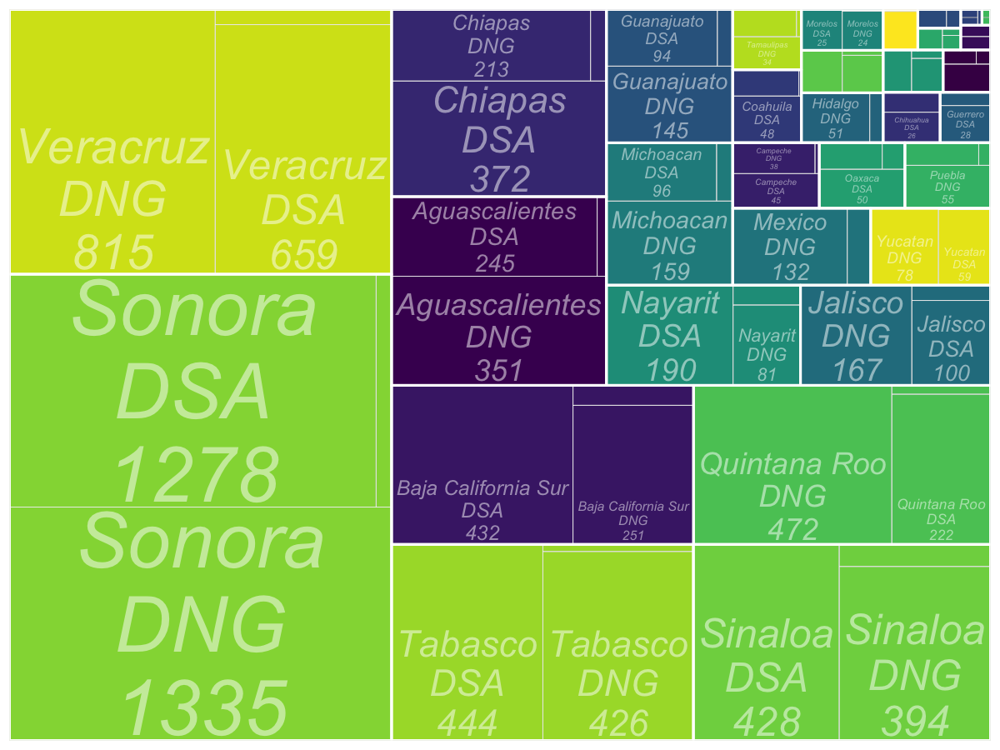
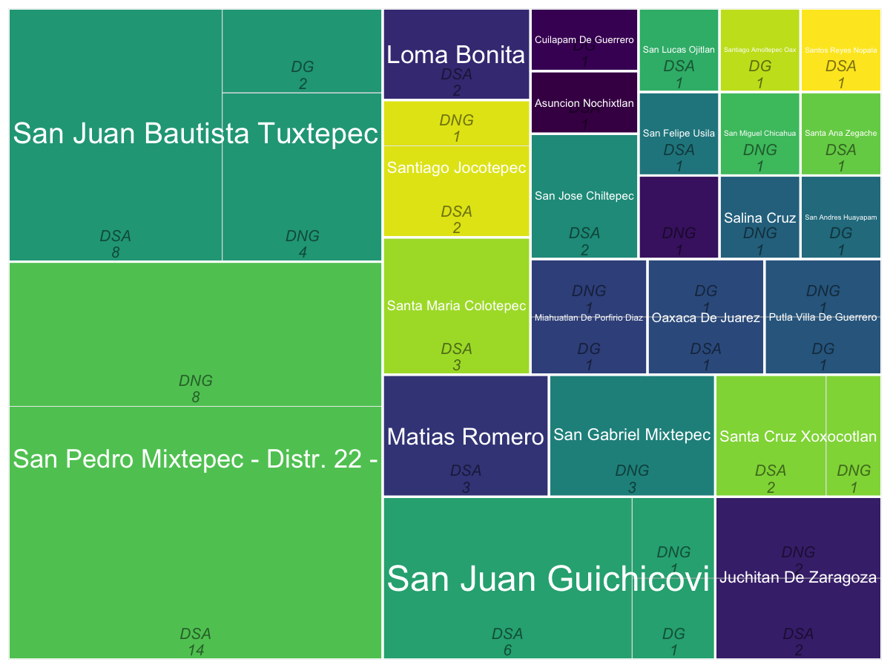
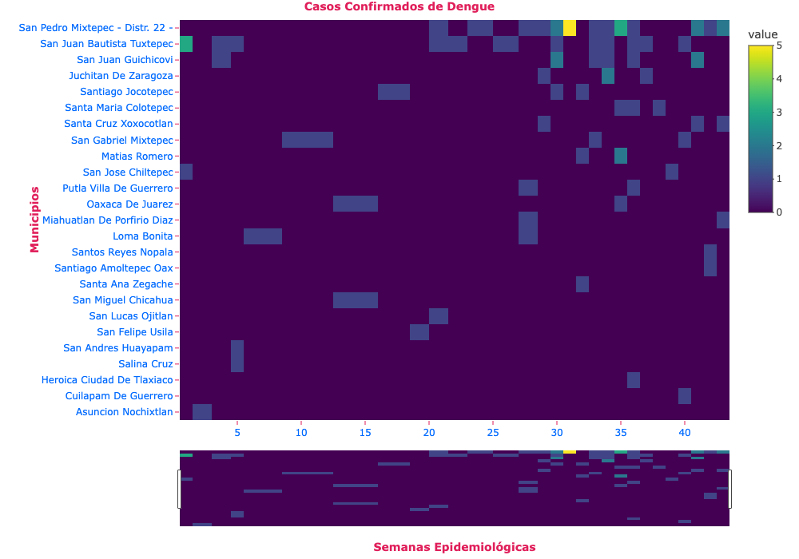

<!-- Vignette precalculado. Editar graficos.Rmd.orig (no el .Rmd) y regenerar
     en la computadora con los datos, desde la carpeta vignettes/:
     knitr::knit("graficos.Rmd.orig", "graficos.Rmd")
     Solo se publican conteos agregados. -->


[English version](graphs.html)

## Introducción

**densnv** tiene cuatro funciones para graficar los casos de dengue de la base del SINAVE:


|función        |gráfico                                                                   |salida           |
|:--------------|:-------------------------------------------------------------------------|:----------------|
|plt_pyramid()  |Pirámide de casos confirmados por grupo de edad y sexo                    |ggplot           |
|plt_serotype() |Casos confirmados por estado o municipio y diagnóstico, con los serotipos |ggplot (cowplot) |
|plt_treemap()  |Treemap de casos por estado o municipio y diagnóstico final               |ggplot           |
|plt_heatmap()  |Mapa de calor interactivo (plotly) de casos por municipio y semana        |plotly           |


``` r
library(densnv)
```

## Datos


``` r
x <- data.table::fread("DENGUE2_.txt", quote = "", fill = TRUE)
```


``` r
anio <- max(x$ANO, na.rm = TRUE)
anio
#> [1] 2026
```

## Pirámide por edad y sexo

`plt_pyramid()` usa los casos confirmados (`ESTATUS_CASO == 2`) en 15 grupos de edad, con hombres a la izquierda y mujeres a la derecha. Cada lado lleva un ícono de Font Awesome y el total de casos por sexo, que funcionan como leyenda. Para un estado o municipio, se filtra la base antes:


``` r
oax <- x[x$CVE_EDO_REP == 20 & x$ANO == anio, ]
plt_pyramid(data = oax,
            col_male = "#0072B2",
            col_female = "#CC79A7",
            gap = 0.18,
            size_age = 3.5,
            size_count = 3,
            icon_male = "person",
            icon_female = "person-dress",
            show_zero = FALSE,
            title = "Casos confirmados de dengue por grupo de edad y sexo",
            subtitle = paste0("Oaxaca, ", anio),
            caption = "Fuente: SINAVE/DGE, Secretaría de Salud.")
```

<div class="figure">

<p class="caption">plot of chunk piramide</p>
</div>

Para guardarla en alta resolución: `ggplot2::ggsave("piramide.png", width = 8, height = 7, dpi = 300)`.

## Casos por diagnóstico y serotipo

`plt_serotype()` grafica los casos confirmados por estado (o por municipio, con `cve_edo`) y diagnóstico final, e inserta un gráfico de los serotipos. `scale_serotype`, `x_serotype` y `y_serotype` definen el tamaño y la posición del gráfico insertado (ver `cowplot::draw_plot()`); conviene ajustarlos según el número de barras.


``` r
plt_serotype(data = x,
             year = anio,
             scale_serotype = 1.7,
             x_serotype = 0.5,
             y_serotype = 0.17,
             cve_edo = NULL)
```

<div class="figure">

<p class="caption">plot of chunk serotipo_pais</p>
</div>

Un estado (Oaxaca), por municipio:


``` r
plt_serotype(data = x,
             year = anio,
             scale_serotype = 1.7,
             x_serotype = 0.5,
             y_serotype = 0.17,
             cve_edo = 20)
```

<div class="figure">

<p class="caption">plot of chunk serotipo_oaxaca</p>
</div>

## Treemap

`plt_treemap()` muestra el peso de cada estado (o municipio) en el total de casos, por diagnóstico final (dengue no grave, con signos de alarma y grave).


``` r
plt_treemap(snv_dataset = x,
            country = TRUE,
            cve_edo = NULL,
            year = anio)
```

<div class="figure">

<p class="caption">plot of chunk treemap_pais</p>
</div>


``` r
plt_treemap(snv_dataset = x,
            country = FALSE,
            cve_edo = 20,
            year = anio)
```

<div class="figure">

<p class="caption">plot of chunk treemap_oaxaca</p>
</div>

## Mapa de calor por municipio y semana

`plt_heatmap()` hace un mapa de calor interactivo (plotly): municipios en las filas, semanas epidemiológicas en las columnas y el número de casos en el color. Con `hospitalizados = TRUE` solo cuenta los casos hospitalizados.


``` r
plt_heatmap(dataset = x,
            state = "OAXACA",
            year = anio,
            status = 2,
            hospitalizados = FALSE)
```

<div class="figure">

<p class="caption">plot of chunk heatmap_fig</p>
</div>

## Notas

1. Las funciones usan el estado y municipio de **reporte** (`*_REP`).
2. `plt_pyramid()` necesita los paquetes fontawesome y rsvg para los íconos; se conservan al guardar con `ggsave()`.
3. Para presentaciones, los gráficos ggplot se pueden modificar con capas de ggplot2 (`+ ggplot2::theme(...)`).
