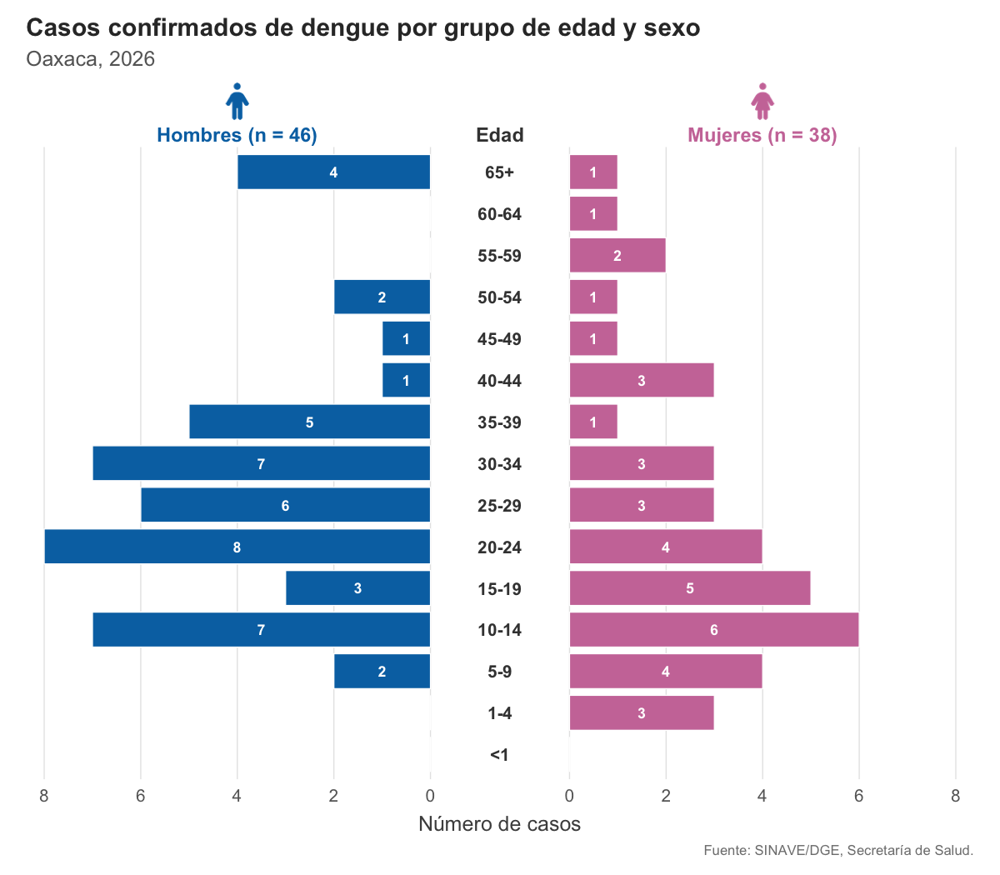
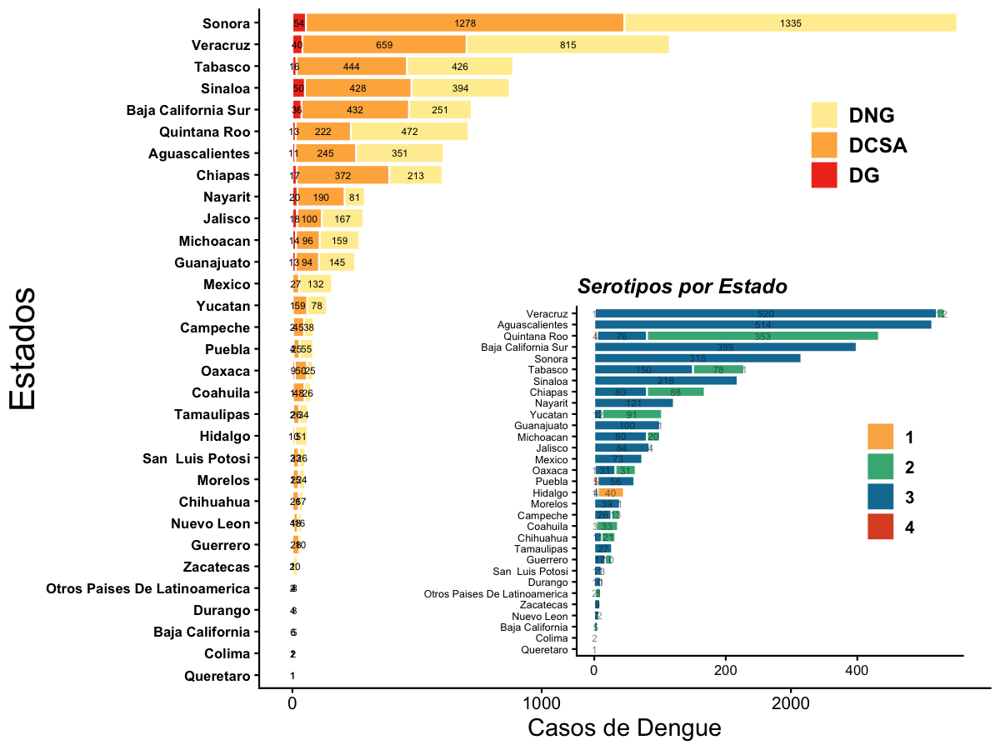
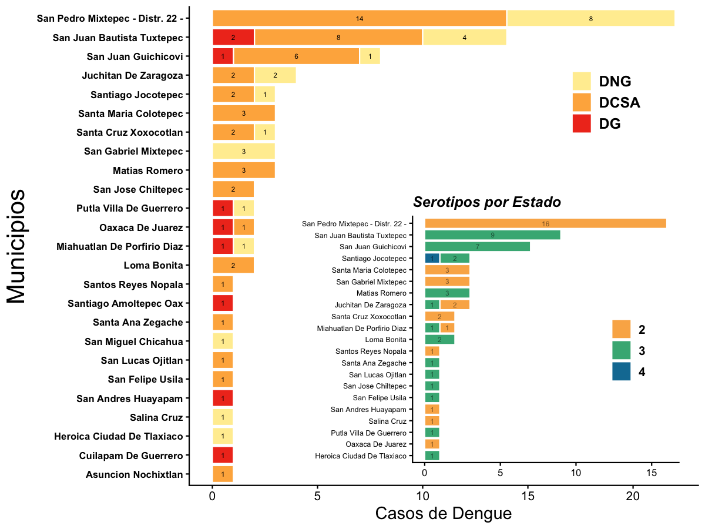
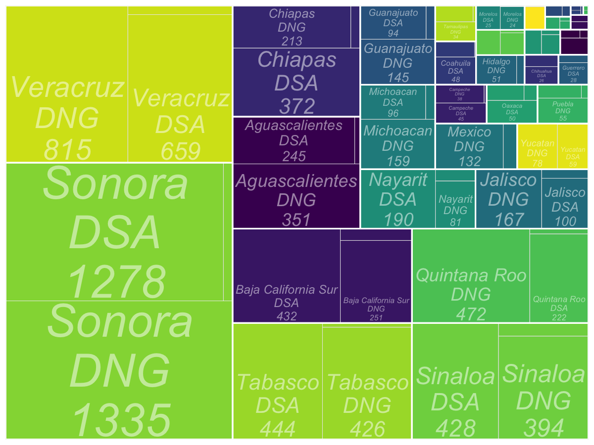
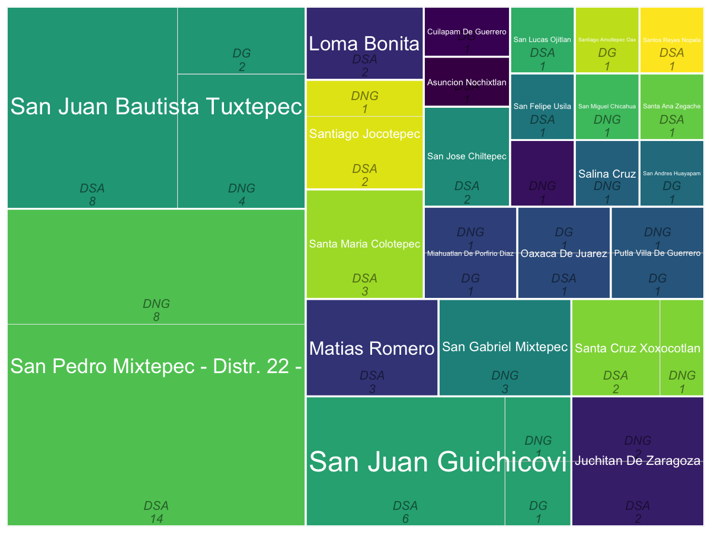
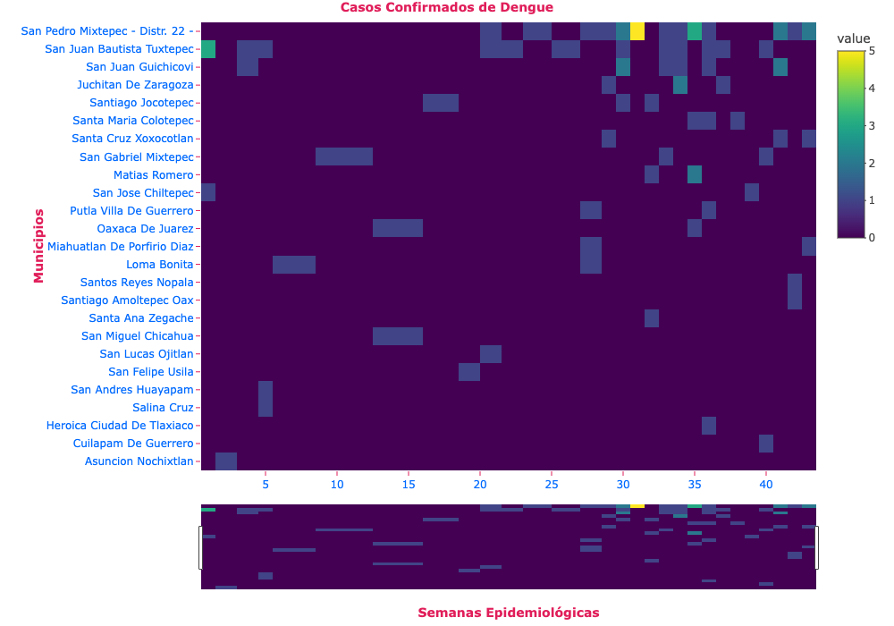

<!-- Precomputed vignette. Edit graphs.Rmd.orig (not the .Rmd) and rebuild on
     the computer with the data, from the vignettes/ folder:
     knitr::knit("graphs.Rmd.orig", "graphs.Rmd")
     Only aggregated counts are published. -->


[Versión en español](graficos.html)

## Introduction

**densnv** has four functions to plot the dengue cases of the SINAVE dataset:


|function       |graph                                                                      |output           |
|:--------------|:--------------------------------------------------------------------------|:----------------|
|plt_pyramid()  |Pyramid of confirmed cases by age group and sex                            |ggplot           |
|plt_serotype() |Confirmed cases by state or municipality and diagnosis, with the serotypes |ggplot (cowplot) |
|plt_treemap()  |Treemap of cases by state or municipality and final diagnosis              |ggplot           |
|plt_heatmap()  |Interactive heatmap (plotly) of cases by municipality and week             |plotly           |


Titles and labels are in Spanish, the language of the users of the Mexican vector-borne disease program.


``` r
library(densnv)
```

## Data


``` r
x <- data.table::fread("DENGUE2_.txt", quote = "", fill = TRUE)
```


``` r
year <- max(x$ANO, na.rm = TRUE)
year
#> [1] 2026
```

## Pyramid by age and sex

`plt_pyramid()` uses the confirmed cases (`ESTATUS_CASO == 2`) in 15 age groups, with males on the left and females on the right. Each side is headed by a Font Awesome icon and the total cases by sex, which act as the legend. For a state or municipality, filter the dataset first:


``` r
oax <- x[x$CVE_EDO_REP == 20 & x$ANO == year, ]
plt_pyramid(data = oax,
            col_male = "#0072B2",
            col_female = "#CC79A7",
            gap = 0.18,
            size_age = 3.5,
            size_count = 3,
            icon_male = "person",
            icon_female = "person-dress",
            show_zero = FALSE,
            title = "Casos confirmados de dengue por grupo de edad y sexo",
            subtitle = paste0("Oaxaca, ", year),
            caption = "Fuente: SINAVE/DGE, Secretaría de Salud.")
```

<div class="figure">

<p class="caption">plot of chunk pyramid</p>
</div>

To save it in high resolution: `ggplot2::ggsave("pyramid.png", width = 8, height = 7, dpi = 300)`.

## Cases by diagnosis and serotype

`plt_serotype()` plots the confirmed cases by state (or by municipality, with `cve_edo`) and final diagnosis, and inserts a plot of the serotypes. `scale_serotype`, `x_serotype` and `y_serotype` set the size and position of the inserted plot (see `cowplot::draw_plot()`); adjust them to the number of bars.


``` r
plt_serotype(data = x,
             year = year,
             scale_serotype = 1.7,
             x_serotype = 0.5,
             y_serotype = 0.17,
             cve_edo = NULL)
```

<div class="figure">

<p class="caption">plot of chunk serotype_country</p>
</div>

One state (Oaxaca), by municipality:


``` r
plt_serotype(data = x,
             year = year,
             scale_serotype = 1.7,
             x_serotype = 0.5,
             y_serotype = 0.17,
             cve_edo = 20)
```

<div class="figure">

<p class="caption">plot of chunk serotype_oaxaca</p>
</div>

## Treemap

`plt_treemap()` shows the weight of each state (or municipality) in the total cases, by final diagnosis (non-severe dengue, with warning signs and severe).


``` r
plt_treemap(snv_dataset = x,
            country = TRUE,
            cve_edo = NULL,
            year = year)
```

<div class="figure">

<p class="caption">plot of chunk treemap_country</p>
</div>


``` r
plt_treemap(snv_dataset = x,
            country = FALSE,
            cve_edo = 20,
            year = year)
```

<div class="figure">

<p class="caption">plot of chunk treemap_oaxaca</p>
</div>

## Heatmap by municipality and week

`plt_heatmap()` makes an interactive heatmap (plotly): municipalities in the rows, epidemiological weeks in the columns and the number of cases in the colour. With `hospitalizados = TRUE` only hospitalised cases are counted.


``` r
plt_heatmap(dataset = x,
            state = "OAXACA",
            year = year,
            status = 2,
            hospitalizados = FALSE)
```

<div class="figure">

<p class="caption">plot of chunk heatmap_fig</p>
</div>

## Notes

1. The functions use the state and municipality of **report** (`*_REP`).
2. `plt_pyramid()` needs the fontawesome and rsvg packages for the icons; they are kept when saving with `ggsave()`.
3. The ggplot graphs can be modified with ggplot2 layers (`+ ggplot2::theme(...)`).
