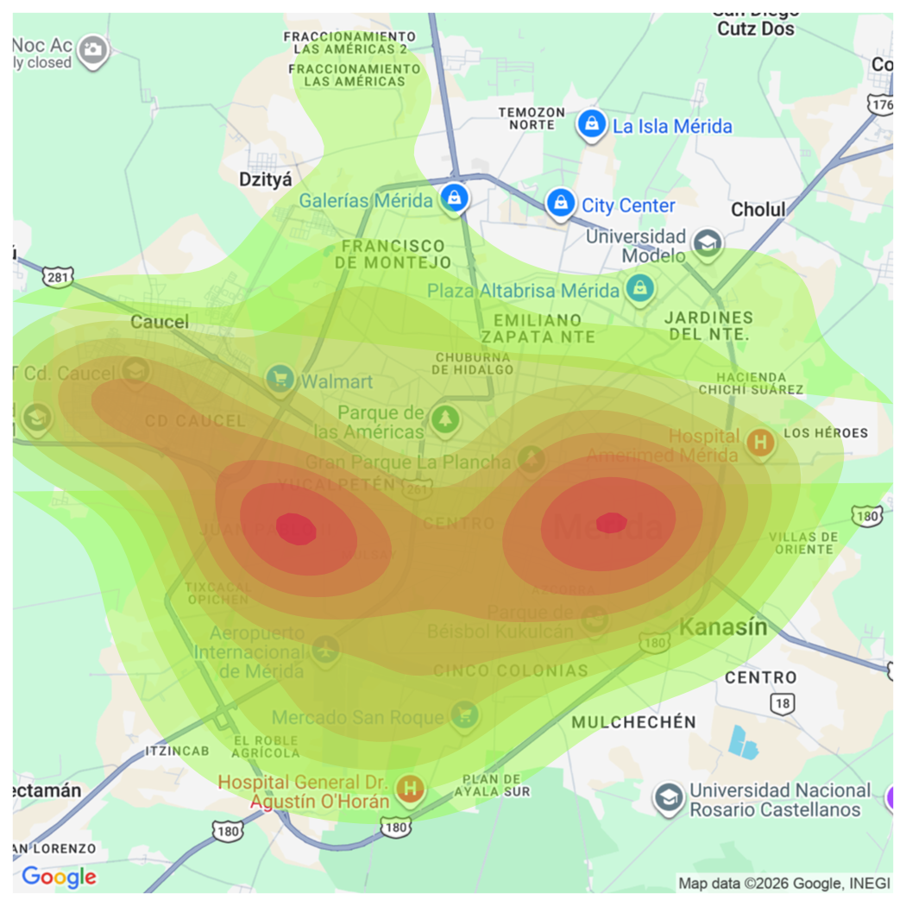
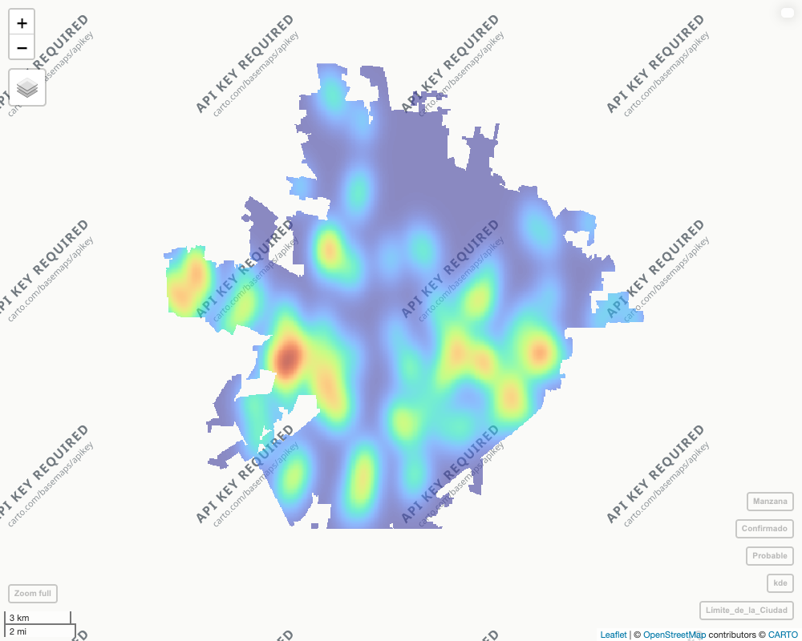
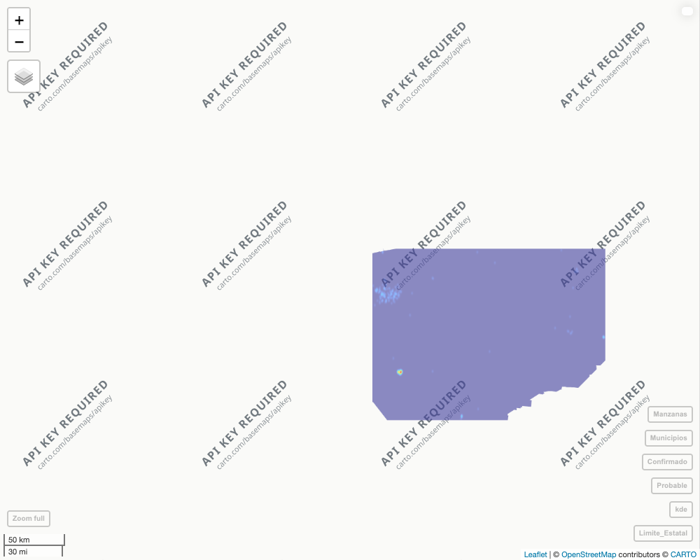

<!-- Precomputed vignette. Edit heatmaps.Rmd.orig (not the .Rmd) and rebuild on
     the computer with the data, from the vignettes/ folder:
     knitr::knit("heatmaps.Rmd.orig", "heatmaps.Rmd")
     CONFIDENTIALITY: in the screenshots of the interactive maps the case layers
     (Probable, Confirmado) are hidden; only density, blocks and boundaries. -->


[Versión en español](mapas_de_calor.html)

## Introduction

A **heatmap** shows the density of cases: where they concentrate, even if they do not form foci under a strict criterion. It helps to delimit the areas of highest risk and to select the blocks to treat. **densnv** has two functions:


|function         |level    |output                                                                                                                  |
|:----------------|:--------|:-----------------------------------------------------------------------------------------------------------------------|
|mp_heatmap()     |Locality |Static (Google Maps, ggplot) or interactive (mapview) map with the density, the cases and the blocks of highest density |
|mp_heatmap_edo() |State    |Interactive map (mapview) with the density, the cases and the blocks of highest density                                 |


The density is estimated with a **bivariate Gaussian kernel** (`KernSmooth::bkde2D()`, bandwidth of 0.0045° of longitude by 0.0068° of latitude, about 470 × 750 m at 20° of latitude, on a 500 × 500 grid) and clipped to the polygon of the locality or the state.


``` r
library(densnv)
```

## Data


``` r
load("dengue_mx_2026.RData")    # geocoded cases: z
```


The geocoded cases with `long`, `lat`, `ESTATUS_CASO` and `SEM` (epidemiological week) are needed. `mp_heatmap_edo()` also uses `accuracy`, to drop the cases geocoded only at locality level.

The last four weeks (active transmission):


``` r
year <- max(z$ANO, na.rm = TRUE)
weeks <- max(z$SEM[z$ANO == year], na.rm = TRUE) - 3:0
weeks
#> [1] 42 43 44 45
```

## How to choose the `kernel` threshold

The `kernel` argument selects the blocks where the density is **greater than or equal** to that value. The scale of the density depends on the number of cases and the area, so it is better to choose it from the percentiles of the density of the locality. This chunk computes the density as `mp_heatmap()` does:


``` r
loc <- rgeomex::extract_locality(cve_edo = "31", locality = "Merida") |>
  sf::st_transform(4326) |>
  sf::st_make_valid()
loc$NOMGEO <- NULL

pts <- z |>
  as.data.frame() |>
  dplyr::filter(!is.na(long), !is.na(lat),
                ESTATUS_CASO %in% c(1, 2), SEM %in% weeks) |>
  sf::st_as_sf(coords = c("long", "lat"), crs = 4326, remove = FALSE)
pts <- pts[loc, ]

kde <- KernSmooth::bkde2D(x = cbind(pts$long, pts$lat),
                          bandwidth = c(0.0045, 0.0068),
                          gridsize = c(500, 500))
dens <- raster::raster(list(x = kde$x1, y = kde$x2, z = kde$fhat)) |>
  terra::rast() |>
  terra::mask(mask = terra::vect(loc))
v <- terra::values(dens, na.rm = TRUE)
v <- v[v > 0]
thresholds <- stats::quantile(v, c(0.50, 0.75, 0.90, 0.95))
round(thresholds, 1)
#>   50%   75%   90%   95% 
#>  33.8  69.2 113.9 139.6
```

With the 90th percentile, the blocks of the 10% of the area with the highest density are selected:


``` r
kernel_p90 <- unname(thresholds["90%"])
```

## Locality: `mp_heatmap()`

### Static map

With `static = TRUE` the density is drawn over Google Maps. This map **does not show the cases**, only the density, so it is the one for reports and presentations. It needs a Google API key registered with `ggmap::register_google()`.


``` r
mp_heatmap(locality = "Merida",
           cve_edo = "31",
           geocoded_dataset = z,
           status_caso = c(1, 2),
           week = weeks,
           kernel = kernel_p90,
           alpha = 0.4,
           zoom = 12,
           map_type = "roadmap",
           static = TRUE,
           palette = NULL,
           save = FALSE)
```

<div class="figure">

<p class="caption">plot of chunk static_fig</p>
</div>

### Interactive map

With `static = FALSE` the function returns an interactive map (mapview) with five layers: the locality boundary, the density (`palette`, e.g. `viridis::turbo`), the probable and confirmed cases, and the **blocks with density ≥ `kernel`**, proposed for control. With `save = TRUE` those blocks are saved as a shapefile.


``` r
mp_heatmap(locality = "Merida",
           cve_edo = "31",
           geocoded_dataset = z,
           status_caso = c(1, 2),
           week = weeks,
           kernel = kernel_p90,
           alpha = 0.6,
           zoom = 12,
           map_type = "roadmap",
           static = FALSE,
           palette = viridis::turbo,
           save = FALSE)
```

<div class="figure">

<p class="caption">plot of chunk interactive_fig</p>
</div>

For confidentiality, the case layers ("Probable" and "Confirmado") are hidden in the screenshot; in the interactive map they are turned on in the layers control.

## State: `mp_heatmap_edo()`

It does the same for a whole state:


``` r
mp_heatmap_edo(cve_edo = "31",
               geocoded_dataset = z,
               week = weeks,
               kernel = kernel_p90,
               alpha = 0.6,
               palette = viridis::turbo)
```

<div class="figure">

<p class="caption">plot of chunk state_fig</p>
</div>

The threshold chosen for a locality is not necessarily valid for the state: the density spreads over a larger area. Compute the percentiles with the cases of the state.

## Heatmaps and active foci

1. The **heatmap** shows where the cases of a period concentrate, without a distance or time criterion between them.
2. The **active foci** of `mp_active_foci()` require a minimum of cases within 400 m and within the temporal window, and come with the Knox test and the diagnosis of the scenario (see the vignette *Active transmission foci and epidemiological scenarios*).

They are complementary: the heatmap gives the overall picture and the foci tell where to intervene first.

## Notes

1. The bandwidth is fixed in degrees (about 470 × 750 m in the centre of the country); in the north or south of the country the equivalent distance changes slightly.
2. With few cases the density depends a lot on each case; use at least 4 weeks.
3. `mp_heatmap()` uses the cases with status `status_caso`; `mp_heatmap_edo()` uses all the geocoded cases of the given weeks.
