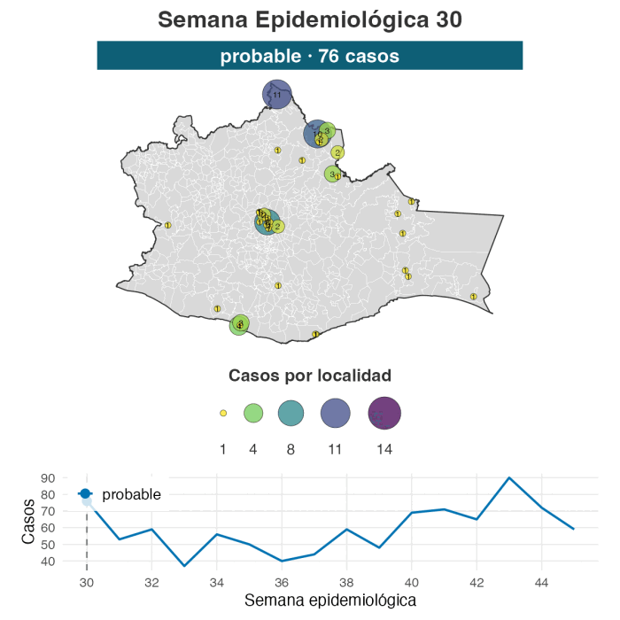
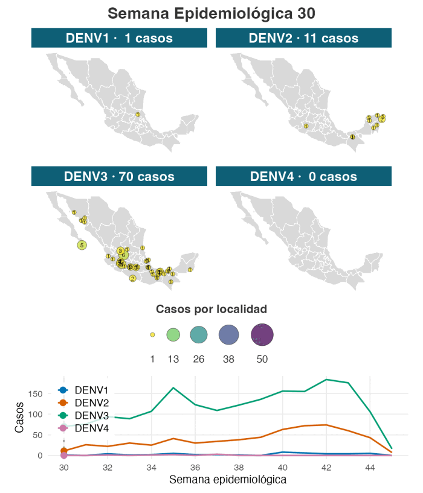
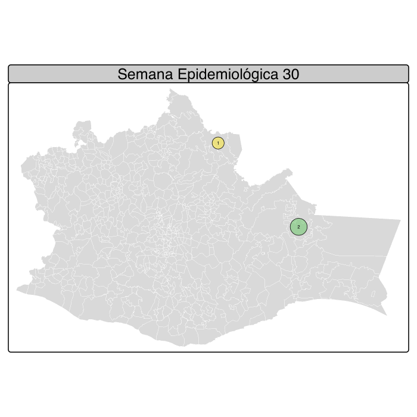

<!-- Vignette precalculado. Editar mapas_animados.Rmd.orig (no el .Rmd) y
     regenerar en la computadora con los datos, desde la carpeta vignettes/:
     knitr::knit("mapas_animados.Rmd.orig", "mapas_animados.Rmd")
     Los gif (vignettes/figures/anim-*.gif) los comparte con la versión en
     inglés; se generan solo si no existen (bórralos para actualizarlos).
     Solo se publican conteos agregados por localidad y municipio. -->


[English version](animated_maps.html)

## Introducción

Un mapa animado muestra **cómo se mueve la transmisión** semana a semana: dónde empieza, hacia dónde se extiende y cuándo cede. **densnv** tiene dos funciones:


|función           |unidad                              |casos                                                                       |motor                                          |
|:-----------------|:-----------------------------------|:---------------------------------------------------------------------------|:----------------------------------------------|
|mp_animated_loc() |Localidad (círculos proporcionales) |Probables, confirmados, diagnóstico final o serotipo; uno o varios a la vez |ggplot2 + gifski, con curva epidémica opcional |
|mp_animated_mpo() |Municipio (círculos o coroplético)  |Confirmados (DNG, DCSA y DG)                                                |tmap + gifski                                  |


``` r
library(densnv)
```

## Datos


``` r
ruta <- "DENGUE2_.txt"
x <- data.table::fread(ruta, quote = "", fill = TRUE)
```


## Por localidad: `mp_animated_loc()`

Cuenta los casos por localidad de reporte y semana epidemiológica, y los dibuja como círculos proporcionales sobre los límites estatales (país) o municipales (estado). Las escalas de tamaño y color son **las mismas en todos los cuadros**, así que las semanas se pueden comparar. Con `curve = TRUE` agrega debajo la curva epidémica, con la semana actual marcada.

### Un estado: Oaxaca


``` r
mp_animated_loc(path = ruta,
                snv_dataset = "DENV",
                year = 2026,
                week = 1:52,
                var = "probable",
                multi = "sum",
                country = FALSE,
                cve_edo = "20",
                breaks = NULL,
                pal = "-viridis",
                text_size = 0.4,
                fps = 2,
                curve = TRUE,
                map_legend = TRUE,
                legend_title = "Casos por localidad",
                save = TRUE,
                name = "dengue_oaxaca_2026",
                dir = "./")
```


<div class="figure">

<p class="caption">plot of chunk loc_oaxaca_fig</p>
</div>

### Varios tipos de casos

El argumento `var` acepta uno o varios valores: `"probable"`, `"confirmado"`, `"DNG"`, `"DCSA"`, `"DG"`, `"DENV1"` a `"DENV4"`. Con varios, `multi` decide cómo combinarlos:

1. **`multi = "sum"`:** los suma en un solo mapa (por ejemplo, las formas graves, `c("DCSA", "DG")`).
2. **`multi = "facet"`:** un panel por valor, con la misma escala (por ejemplo, un panel por serotipo). Un caso puede aparecer en más de un panel.


``` r
mp_animated_loc(path = ruta,
                snv_dataset = "DENV",
                year = 2026,
                week = 1:52,
                var = c("DENV1", "DENV2", "DENV3", "DENV4"),
                multi = "facet",
                ncol = 2,
                country = TRUE,
                cve_edo = NULL,
                curve = TRUE,
                save = TRUE,
                name = "serotipos_mexico_2026",
                dir = "./")
```


<div class="figure">

<p class="caption">plot of chunk loc_serotipos_fig</p>
</div>

## Por municipio: `mp_animated_mpo()`

Cuenta los casos confirmados (dengue no grave, con signos de alarma y grave) por municipio de residencia y semana. Con `dot = TRUE` dibuja círculos proporcionales; con `dot = FALSE`, un mapa coroplético con la paleta `pal`.


``` r
mp_animated_mpo(data = x,
                year = 2026,
                name = "Oaxaca",
                dir = "./",
                country = FALSE,
                breaks = NULL,
                save = TRUE,
                cve_edo = "20",
                text_size = 0.3,
                dot = TRUE,
                pal = viridis::viridis)
```


<div class="figure">

<p class="caption">plot of chunk mpo_oaxaca_fig</p>
</div>

## Recomendaciones

1. **Tamaño del gif:** con 52 semanas y todo el país, el gif puede pesar varios MB. Para presentaciones conviene `fps = 2` o `3` y limitar `week` al periodo de interés.
2. **Comparar semanas:** como las escalas son las mismas en todos los cuadros, un círculo del mismo tamaño significa el mismo número de casos en cualquier semana.
3. **Guardar:** con `save = TRUE` el gif queda en `dir`; con `save = FALSE` solo se muestra en el Viewer de RStudio.
4. Los gif de este vignette muestran solo las últimas 16 semanas y están reducidos de tamaño.

## Notas

1. `mp_animated_loc()` usa la localidad de **reporte** y el catálogo de localidades del INEGI 2020 (`rgeomex::iter_2020_loc`).
2. `mp_animated_mpo()` usa el municipio de **residencia** y excluye los casos de otros países.
3. Las dos funciones necesitan el paquete gifski.
