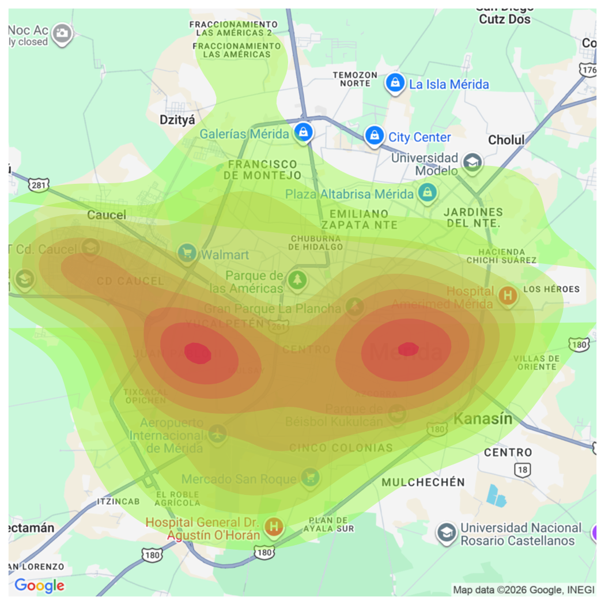
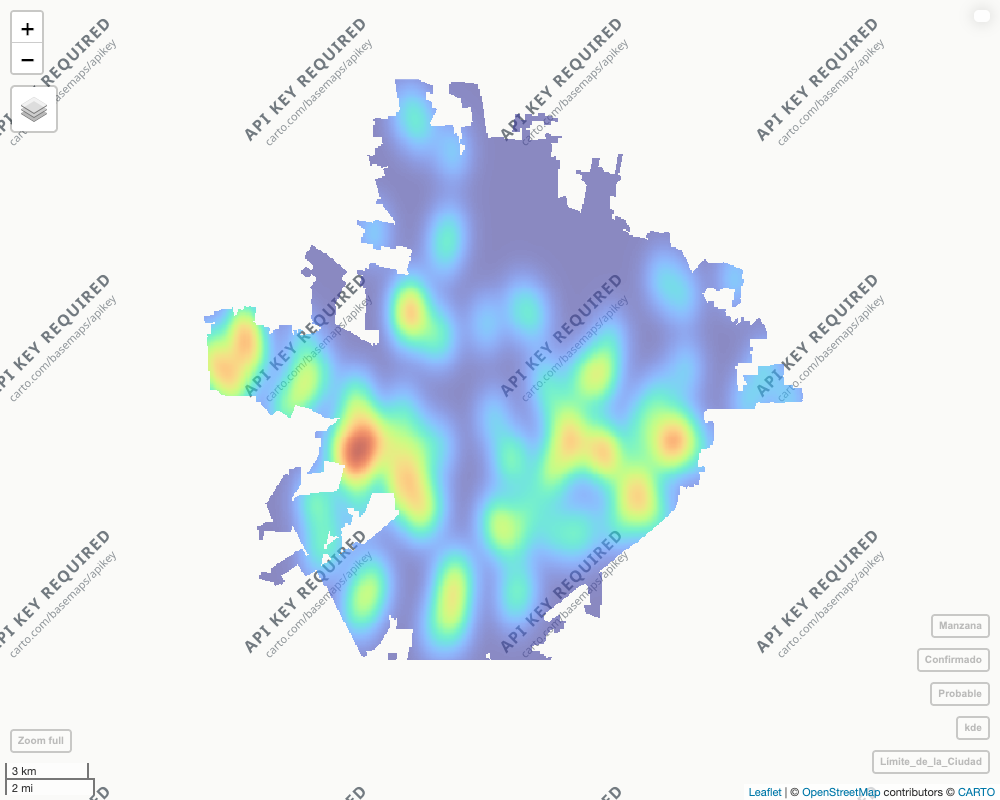
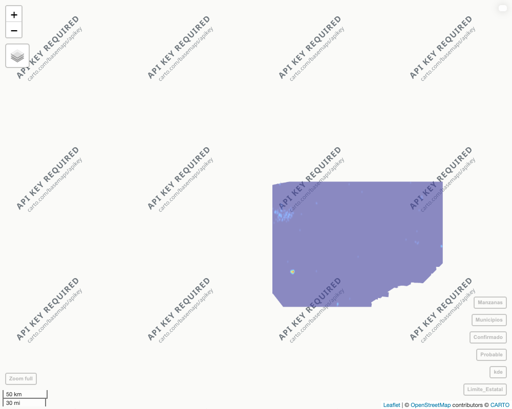

<!-- Vignette precalculado. Editar mapas_de_calor.Rmd.orig (no el .Rmd) y
     regenerar en la computadora con los datos, desde la carpeta vignettes/:
     knitr::knit("mapas_de_calor.Rmd.orig", "mapas_de_calor.Rmd")
     CONFIDENCIALIDAD: en las capturas de los mapas interactivos se ocultan las
     capas de casos (Probable, Confirmado); solo densidad, manzanas y límites. -->


[English version](heatmaps.html)

## Introducción

Un **mapa de calor** muestra la densidad de casos: dónde se concentran, aunque no formen focos con un criterio estricto. Es útil para delimitar las áreas de mayor riesgo y seleccionar las manzanas a intervenir. **densnv** tiene dos funciones:


|función          |nivel     |salida                                                                                                                  |
|:----------------|:---------|:-----------------------------------------------------------------------------------------------------------------------|
|mp_heatmap()     |Localidad |Mapa estático (Google Maps, ggplot) o interactivo (mapview) con la densidad, los casos y las manzanas de mayor densidad |
|mp_heatmap_edo() |Estado    |Mapa interactivo (mapview) con la densidad, los casos y las manzanas de mayor densidad                                  |


La densidad se estima con un **kernel gaussiano bivariado** (`KernSmooth::bkde2D()`, ancho de banda de 0.0045° de longitud por 0.0068° de latitud, unos 470 × 750 m a 20° de latitud, en una malla de 500 × 500) y se recorta al polígono de la localidad o del estado.


``` r
library(densnv)
```

## Datos


``` r
load("dengue_mx_2026.RData")    # casos geocodificados: z
```


Se necesitan los casos geocodificados con `long`, `lat`, `ESTATUS_CASO` y `SEM` (semana epidemiológica). `mp_heatmap_edo()` usa también `accuracy`, para quitar los casos geocodificados solo a nivel de localidad.

Las últimas cuatro semanas (transmisión activa):


``` r
anio <- max(z$ANO, na.rm = TRUE)
semanas <- max(z$SEM[z$ANO == anio], na.rm = TRUE) - 3:0
semanas
#> [1] 42 43 44 45
```

## Cómo elegir el umbral `kernel`

El argumento `kernel` selecciona las manzanas donde la densidad es **mayor o igual** a ese valor. La escala de la densidad depende del número de casos y del área, así que conviene elegirlo con los percentiles de la densidad de la localidad. Este bloque calcula la densidad igual que `mp_heatmap()`:


``` r
loc <- rgeomex::extract_locality(cve_edo = "31", locality = "Merida") |>
  sf::st_transform(4326) |>
  sf::st_make_valid()
loc$NOMGEO <- NULL

pts <- z |>
  as.data.frame() |>
  dplyr::filter(!is.na(long), !is.na(lat),
                ESTATUS_CASO %in% c(1, 2), SEM %in% semanas) |>
  sf::st_as_sf(coords = c("long", "lat"), crs = 4326, remove = FALSE)
pts <- pts[loc, ]

kde <- KernSmooth::bkde2D(x = cbind(pts$long, pts$lat),
                          bandwidth = c(0.0045, 0.0068),
                          gridsize = c(500, 500))
dens <- raster::raster(list(x = kde$x1, y = kde$x2, z = kde$fhat)) |>
  terra::rast() |>
  terra::mask(mask = terra::vect(loc))
v <- terra::values(dens, na.rm = TRUE)
v <- v[v > 0]
umbrales <- stats::quantile(v, c(0.50, 0.75, 0.90, 0.95))
round(umbrales, 1)
#>   50%   75%   90%   95% 
#>  33.8  69.2 113.9 139.6
```

Con el percentil 90 se seleccionan las manzanas del 10% del área con mayor densidad:


``` r
kernel_p90 <- unname(umbrales["90%"])
```

## Localidad: `mp_heatmap()`

### Mapa estático

Con `static = TRUE` se dibuja la densidad sobre Google Maps. Este mapa **no muestra los casos**, solo la densidad, así que es el adecuado para informes y presentaciones. Necesita una API key de Google registrada con `ggmap::register_google()`.


``` r
mp_heatmap(locality = "Merida",
           cve_edo = "31",
           geocoded_dataset = z,
           status_caso = c(1, 2),
           week = semanas,
           kernel = kernel_p90,
           alpha = 0.4,
           zoom = 12,
           map_type = "roadmap",
           static = TRUE,
           palette = NULL,
           save = FALSE)
```

<div class="figure">

<p class="caption">plot of chunk estatico_fig</p>
</div>

### Mapa interactivo

Con `static = FALSE` se obtiene un mapa interactivo (mapview) con cinco capas: el límite de la localidad, la densidad (`palette`, por ejemplo `viridis::turbo`), los casos probables y confirmados, y las **manzanas con densidad ≥ `kernel`**, que son las propuestas para el control. Con `save = TRUE` esas manzanas se guardan como shapefile.


``` r
mp_heatmap(locality = "Merida",
           cve_edo = "31",
           geocoded_dataset = z,
           status_caso = c(1, 2),
           week = semanas,
           kernel = kernel_p90,
           alpha = 0.6,
           zoom = 12,
           map_type = "roadmap",
           static = FALSE,
           palette = viridis::turbo,
           save = FALSE)
```

<div class="figure">

<p class="caption">plot of chunk interactivo_fig</p>
</div>

Por confidencialidad, en la captura están ocultas las capas de casos ("Probable" y "Confirmado"); en el mapa interactivo se prenden en el control de capas.

## Estado: `mp_heatmap_edo()`

Hace lo mismo para un estado completo:


``` r
mp_heatmap_edo(cve_edo = "31",
               geocoded_dataset = z,
               week = semanas,
               kernel = kernel_p90,
               alpha = 0.6,
               palette = viridis::turbo)
```

<div class="figure">

<p class="caption">plot of chunk estado_fig</p>
</div>

El umbral elegido para una localidad no sirve necesariamente para el estado: la densidad se reparte en un área mayor. Conviene calcular los percentiles con los casos del estado.

## Mapas de calor y focos activos

1. El **mapa de calor** muestra dónde se concentran los casos de un periodo, sin un criterio de distancia ni de tiempo entre ellos.
2. Los **focos activos** de `mp_active_foci()` exigen un mínimo de casos a 400 m o menos y dentro de la ventana temporal, y se acompañan de la prueba de Knox y del diagnóstico del escenario (ver el vignette *Focos de transmisión activa y escenarios epidemiológicos*).

Los dos son complementarios: el mapa de calor sirve para ver el panorama y el de focos, para decidir dónde intervenir primero.

## Notas

1. El ancho de banda está fijo en grados (unos 470 × 750 m en el centro del país); en el norte o el sur del país la distancia equivalente cambia un poco.
2. Con pocos casos, la densidad depende mucho de cada caso; conviene usar al menos 4 semanas.
3. `mp_heatmap()` usa los casos con estatus `status_caso`; `mp_heatmap_edo()` usa todos los casos geocodificados de las semanas indicadas.
