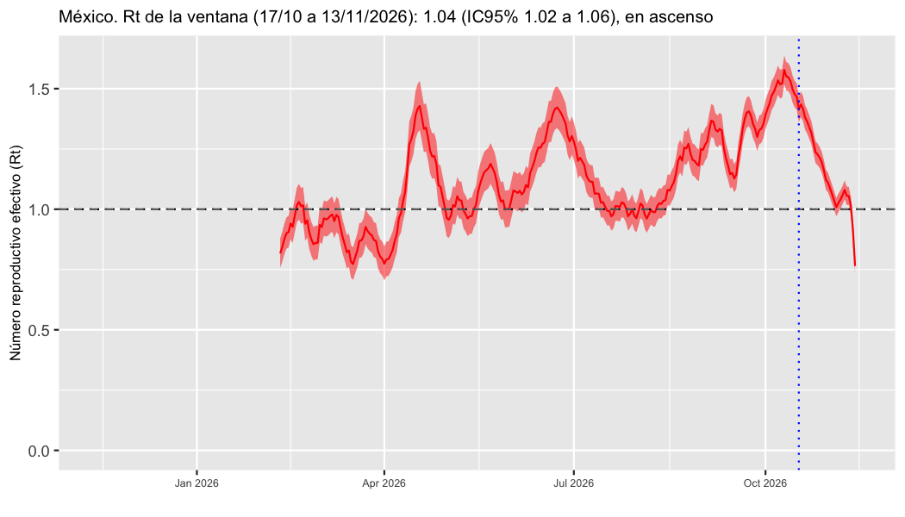
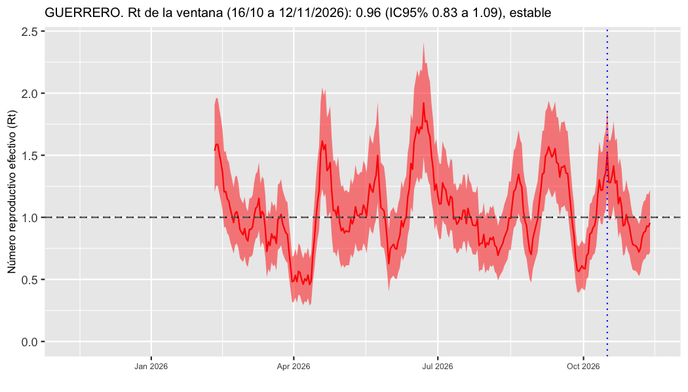
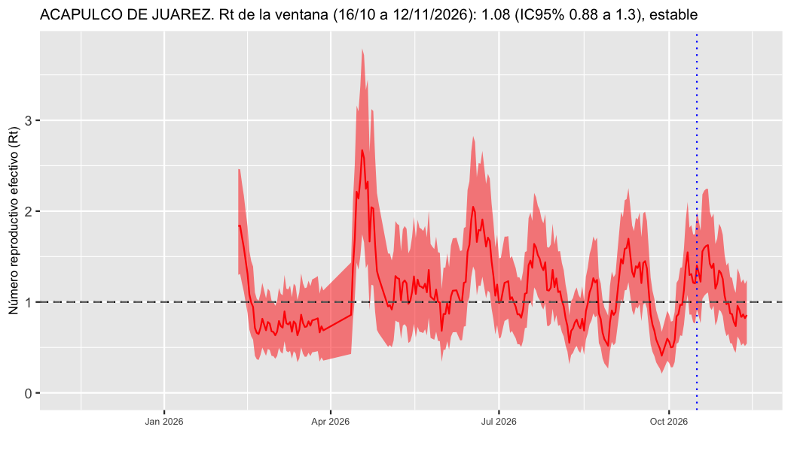
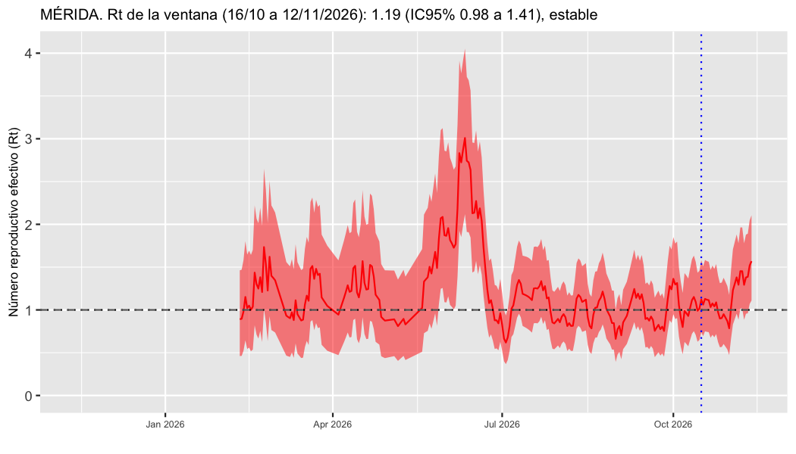

<!-- Vignette precalculado. Editar numero_reproductivo.Rmd.orig (no el .Rmd) y
     regenerar en la computadora con los datos, desde la carpeta vignettes/:
     knitr::knit("numero_reproductivo.Rmd.orig", "numero_reproductivo.Rmd")
     Solo se publican conteos agregados y estimaciones del Rt. -->


[English version](reproduction_number.html)

## Introducción

El **número reproductivo efectivo (Rt)** es el número promedio de casos nuevos que genera cada caso en un momento dado. Si Rt > 1 la transmisión crece; si Rt < 1, disminuye. Junto con la curva epidémica, indica en qué **fase del brote** está un área: en ascenso, estable o en descenso.

La función `rt_dengue()` de **densnv** estima el Rt del dengue para el **país, un estado, un municipio o una localidad**, con la base del SINAVE. La usa también `mp_active_foci()` para diagnosticar el escenario epidemiológico de una localidad.


``` r
library(densnv)
```

## Datos


``` r
load("dengue_mx_2026.RData")
```


Se necesitan `FEC_INI_SIGNOS_SINT`, `ESTATUS_CASO` y, según el nivel, las claves INEGI del lugar de reporte (`CVE_EDO_REP`, `CVE_MPO_REP`, `CVE_LOC_REP`) o de residencia (`*_RES`). No hace falta que los casos estén geocodificados.

## Cómo se calcula

`rt_dengue()` usa el método de Cori et al. (2013), paquete [EpiEstim](https://CRAN.R-project.org/package=EpiEstim). Para cada día compara:

1. **Los casos nuevos** de ese día.
2. **La infecciosidad de los casos previos**: la suma de los casos de los días anteriores, ponderada por el **intervalo serial** (tiempo entre el inicio de síntomas de un caso y el de los casos que genera). Para el dengue se usa una distribución gamma con media `mean_si` = 21 días y desviación estándar `std_si` = 6.1 (incubación intrínseca más extrínseca).

De forma simplificada, **Rt ≈ casos nuevos / infecciosidad de los casos previos**.

### ¿Por qué una ventana?

Los conteos diarios son muy variables: un día 1 caso, otro 8, otro 0. Con un solo día, el Rt saltaría sin que la transmisión cambie de verdad. La ventana junta los casos de varios días y supone el Rt constante en ella. La precisión depende del número de casos en la ventana: el coeficiente de variación del Rt es aproximadamente 1/√(casos).


| casos_en_la_ventana| coeficiente_de_variacion|
|-------------------:|------------------------:|
|                  12|                     0.29|
|                  50|                     0.14|
|                 100|                     0.10|
|                 500|                     0.04|


Hay que equilibrar rapidez y precisión:

1. **Ventana corta (7 días):** detecta pronto los cambios, pero con intervalos anchos.
2. **Ventana larga (28 días):** intervalos angostos, pero tarda en mostrar un cambio de fase. Además, los últimos días de la base están incompletos por el retraso de notificación, y en una ventana larga pesan menos.

`rt_dengue()` estima dos cosas:

1. **La curva:** ventanas semanales móviles con al menos 10 casos, que empiezan `mean_si` + 2 `std_si` días después del inicio de la base (antes no hay historia de casos y el Rt se sobreestima).
2. **El Rt de la ventana actual:** los últimos `window_days` días hasta `ref_date`, con su intervalo de credibilidad del 95%, que da la **fase del brote**:
   1. **En ascenso:** límite inferior > 1.
   2. **Estable:** el intervalo incluye 1.
   3. **En descenso:** límite superior < 1.

## Lugar de reporte o de residencia

El argumento `place` define con qué lugar se seleccionan los casos:

1. **`"REP"` (por defecto), lugar de reporte.** En las áreas no endémicas (por ejemplo, la Ciudad de México) los casos positivos se reportan en el lugar donde se expusieron, así que el lugar de reporte es el lugar de transmisión.
2. **`"RES"`, lugar de residencia.** En las áreas endémicas casi coincide con el de reporte.


``` r
cdmx <- lapply(c("REP", "RES"), function(p)
  rt_dengue(dataset = z,
            level = "state",
            place = p,
            cve_edo = "09",
            status_caso = c(1, 2),
            ref_date = NULL,
            period_days = 365,
            window_days = 28,
            mean_si = 21,
            std_si = 6.1,
            plot = FALSE))
data.frame(lugar = c("REP", "RES"),
           casos = sapply(cdmx, function(r) sum(r$incidencia$I)))
#>   lugar casos
#> 1   REP     9
#> 2   RES    41
```

## Por nivel geográfico

### País


``` r
rt_mx <- rt_dengue(dataset = z,
                   level = "country",
                   place = "REP",
                   cve_edo = NULL,
                   cve_mpo = NULL,
                   cve_loc = NULL,
                   status_caso = c(1, 2),
                   ref_date = NULL,
                   period_days = 365,
                   window_days = 28,
                   mean_si = 21,
                   std_si = 6.1,
                   plot = FALSE)
rt_mx$rt_ventana
#>       inicio        fin casos       rt   rt_inf   rt_sup       fase
#> 1 2026-10-17 2026-11-13 10704 1.043418 1.023745 1.063276 En ascenso
rt_mx$plot
```

<div class="figure">

<p class="caption">plot of chunk pais</p>
</div>

### Estado: Guerrero


``` r
rt_gro <- rt_dengue(dataset = z,
                    level = "state",
                    place = "REP",
                    cve_edo = "12",
                    status_caso = c(1, 2),
                    ref_date = NULL,
                    period_days = 365,
                    window_days = 28,
                    mean_si = 21,
                    std_si = 6.1,
                    plot = FALSE)
rt_gro$rt_ventana
#>       inicio        fin casos        rt    rt_inf   rt_sup    fase
#> 1 2026-10-16 2026-11-12   216 0.9550919 0.8322346 1.086284 Estable
rt_gro$plot
```

<div class="figure">

<p class="caption">plot of chunk estado</p>
</div>

### Municipio: Acapulco de Juárez


``` r
rt_aca <- rt_dengue(dataset = z,
                    level = "municipality",
                    place = "REP",
                    cve_edo = "12",
                    cve_mpo = "001",
                    status_caso = c(1, 2),
                    ref_date = NULL,
                    period_days = 365,
                    window_days = 28,
                    mean_si = 21,
                    std_si = 6.1,
                    plot = FALSE)
rt_aca$rt_ventana
#>       inicio        fin casos   rt   rt_inf   rt_sup    fase
#> 1 2026-10-16 2026-11-12   101 1.08 0.880611 1.299432 Estable
rt_aca$plot
```

<div class="figure">

<p class="caption">plot of chunk municipio</p>
</div>

### Localidad: Mérida


``` r
rt_mid <- rt_dengue(dataset = z,
                    level = "locality",
                    place = "REP",
                    cve_edo = "31",
                    cve_mpo = "050",
                    cve_loc = "0001",
                    status_caso = c(1, 2),
                    ref_date = NULL,
                    period_days = 365,
                    window_days = 28,
                    mean_si = 21,
                    std_si = 6.1,
                    plot = FALSE)
rt_mid$rt_ventana
#>       inicio        fin casos       rt    rt_inf   rt_sup    fase
#> 1 2026-10-16 2026-11-12   115 1.188668 0.9822196 1.414516 Estable
rt_mid$plot
```

<div class="figure">

<p class="caption">plot of chunk localidad</p>
</div>

La línea azul marca el inicio de la ventana y la línea discontinua, Rt = 1.

## Sensibilidad a la ventana


``` r
ventanas <- c(7, 14, 21, 28)
do.call(rbind, lapply(ventanas, function(w){
  r <- rt_dengue(dataset = z, level = "locality", place = "REP",
                 cve_edo = "31", cve_mpo = "050", cve_loc = "0001",
                 status_caso = c(1, 2), ref_date = NULL, period_days = 365,
                 window_days = w, mean_si = 21, std_si = 6.1, plot = FALSE)$rt_ventana
  data.frame(ventana_dias = w, casos = r$casos, rt = round(r$rt, 2),
             ic95 = paste(round(r$rt_inf, 2), "a", round(r$rt_sup, 2)),
             ancho = round(r$rt_sup - r$rt_inf, 2), fase = r$fase)
}))
#>   ventana_dias casos   rt        ic95 ancho       fase
#> 1            7    37 1.57 1.11 a 2.11  1.00 En ascenso
#> 2           14    68 1.42  1.1 a 1.77  0.67 En ascenso
#> 3           21    89 1.24    1 a 1.51  0.51    Estable
#> 4           28   115 1.19 0.98 a 1.41  0.43    Estable
```

Con ventanas más largas hay más casos y el intervalo es más angosto; el Rt se suaviza.

## Sensibilidad al intervalo serial


``` r
si <- c(15, 21, 27)
do.call(rbind, lapply(si, function(m){
  r <- rt_dengue(dataset = z, level = "locality", place = "REP",
                 cve_edo = "31", cve_mpo = "050", cve_loc = "0001",
                 status_caso = c(1, 2), ref_date = NULL, period_days = 365,
                 window_days = 28, mean_si = m, std_si = 6.1, plot = FALSE)$rt_ventana
  data.frame(mean_si = m, rt = round(r$rt, 2),
             ic95 = paste(round(r$rt_inf, 2), "a", round(r$rt_sup, 2)),
             fase = r$fase)
}))
#>   mean_si   rt        ic95    fase
#> 1      15 1.19 0.98 a 1.42 Estable
#> 2      21 1.19 0.98 a 1.41 Estable
#> 3      27 1.19 0.99 a 1.42 Estable
```

Con un intervalo serial más largo, el Rt se aleja de 1 (en ascenso, más alto; en descenso, más bajo), pero la fase suele mantenerse.

## Limitaciones

1. Los últimos días de la base están incompletos por el retraso de notificación, lo que baja el Rt de la ventana actual.
2. El intervalo serial del dengue varía con la temperatura (incubación extrínseca); 21 días es un valor de referencia.
3. Con pocos casos (menos de 50 en el periodo) el Rt es poco confiable; la función lo advierte.
4. Los casos importados se cuentan como locales; en áreas no endémicas conviene `place = "REP"`.

## Referencias

1. Cori A, Ferguson NM, Fraser C, Cauchemez S (2013). A new framework and software to estimate time-varying reproduction numbers during epidemics. *American Journal of Epidemiology*, 178(9), 1505-1512.
2. Thompson RN, Stockwin JE, van Gaalen RD, et al. (2019). Improved inference of time-varying reproduction numbers during infectious disease outbreaks. *Epidemics*, 29, 100356.
