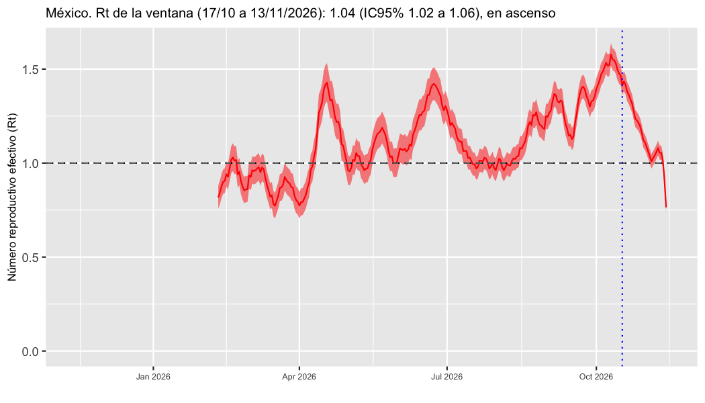
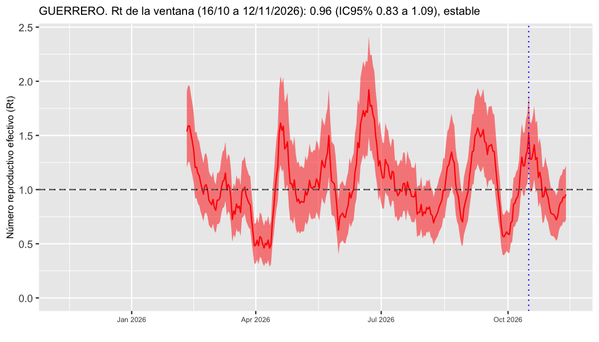
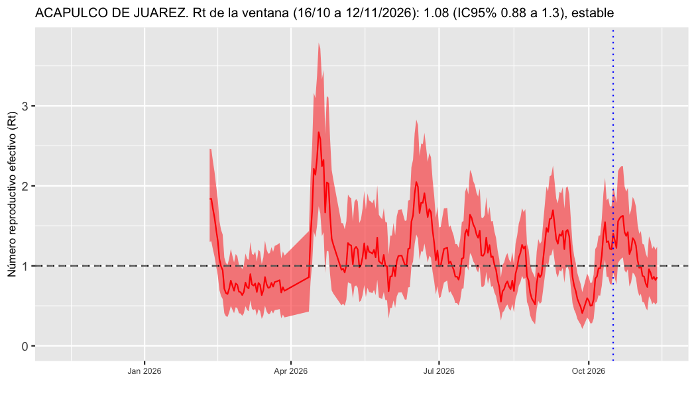
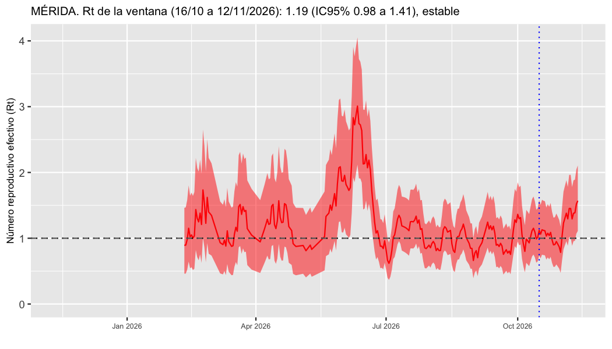

<!-- Precomputed vignette. Edit reproduction_number.Rmd.orig (not the .Rmd) and
     rebuild on the computer with the data, from the vignettes/ folder:
     knitr::knit("reproduction_number.Rmd.orig", "reproduction_number.Rmd")
     Only aggregated counts and Rt estimates are published. -->


[Versión en español](numero_reproductivo.html)

## Introduction

The **effective reproductive number (Rt)** is the average number of new cases generated by each case at a given time. If Rt > 1 transmission grows; if Rt < 1, it declines. Together with the epidemic curve, it tells the **phase of the outbreak** of an area: increasing, stable or decreasing.

The `rt_dengue()` function of **densnv** estimates the Rt of dengue for the **country, a state, a municipality or a locality** with the SINAVE dataset. `mp_active_foci()` also uses it to diagnose the epidemiological scenario of a locality. The phase labels are in Spanish: "En ascenso" (increasing), "Estable" (stable) and "En descenso" (decreasing).


``` r
library(densnv)
```

## Data


``` r
load("dengue_mx_2026.RData")
```


The function needs `FEC_INI_SIGNOS_SINT`, `ESTATUS_CASO` and, depending on the level, the INEGI keys of the place of report (`CVE_EDO_REP`, `CVE_MPO_REP`, `CVE_LOC_REP`) or of residence (`*_RES`). The cases do not need to be geocoded.

## How it is estimated

`rt_dengue()` uses the method of Cori et al. (2013), [EpiEstim](https://CRAN.R-project.org/package=EpiEstim) package. For each day it compares:

1. **The new cases** of that day.
2. **The infectiousness of the previous cases**: the sum of the cases of the previous days, weighted by the **serial interval** (time between the onset of a case and the onset of the cases it generates). For dengue a gamma distribution with mean `mean_si` = 21 days and standard deviation `std_si` = 6.1 is used (intrinsic plus extrinsic incubation).

In short, **Rt ≈ new cases / infectiousness of the previous cases**.

### Why a window?

Daily counts are very noisy: 1 case one day, 8 the next, 0 the next. With a single day, Rt would jump without any real change in transmission. The window pools the cases of several days and assumes Rt constant within it. Precision depends on the number of cases in the window: the coefficient of variation of Rt is about 1/√(cases).


| cases_in_window| coefficient_of_variation|
|---------------:|------------------------:|
|              12|                     0.29|
|              50|                     0.14|
|             100|                     0.10|
|             500|                     0.04|


There is a trade-off between speed and precision:

1. **Short window (7 days):** detects changes sooner, with wide intervals.
2. **Long window (28 days):** narrow intervals, but slower to show a change of phase. The last days of the dataset are incomplete because of the delay of report, and they weigh less in a long window.

`rt_dengue()` estimates two things:

1. **The curve:** weekly sliding windows with at least 10 cases, starting `mean_si` + 2 `std_si` days after the beginning of the dataset (before that there is no history of cases and Rt is overestimated).
2. **The Rt of the current window:** the last `window_days` days up to `ref_date`, with its 95% credible interval, which gives the **phase of the outbreak**:
   1. **En ascenso** (increasing): lower limit > 1.
   2. **Estable** (stable): the interval includes 1.
   3. **En descenso** (decreasing): upper limit < 1.

## Place of report or residence

The `place` argument sets which place is used to select the cases:

1. **`"REP"` (default), place of report.** In non-endemic areas (e.g. Mexico City) the positive cases are reported in the place where they were exposed, so the place of report is the place of transmission.
2. **`"RES"`, place of residence.** In endemic areas it is almost the same as the place of report.


``` r
cdmx <- lapply(c("REP", "RES"), function(p)
  rt_dengue(dataset = z,
            level = "state",
            place = p,
            cve_edo = "09",
            status_caso = c(1, 2),
            ref_date = NULL,
            period_days = 365,
            window_days = 28,
            mean_si = 21,
            std_si = 6.1,
            plot = FALSE))
data.frame(place = c("REP", "RES"),
           cases = sapply(cdmx, function(r) sum(r$incidencia$I)))
#>   place cases
#> 1   REP     9
#> 2   RES    41
```

## By geographic level

### Country


``` r
rt_mx <- rt_dengue(dataset = z,
                   level = "country",
                   place = "REP",
                   cve_edo = NULL,
                   cve_mpo = NULL,
                   cve_loc = NULL,
                   status_caso = c(1, 2),
                   ref_date = NULL,
                   period_days = 365,
                   window_days = 28,
                   mean_si = 21,
                   std_si = 6.1,
                   plot = FALSE)
rt_mx$rt_ventana
#>       inicio        fin casos       rt   rt_inf   rt_sup       fase
#> 1 2026-10-17 2026-11-13 10704 1.043418 1.023745 1.063276 En ascenso
rt_mx$plot
```

<div class="figure">

<p class="caption">plot of chunk country</p>
</div>

### State: Guerrero


``` r
rt_gro <- rt_dengue(dataset = z,
                    level = "state",
                    place = "REP",
                    cve_edo = "12",
                    status_caso = c(1, 2),
                    ref_date = NULL,
                    period_days = 365,
                    window_days = 28,
                    mean_si = 21,
                    std_si = 6.1,
                    plot = FALSE)
rt_gro$rt_ventana
#>       inicio        fin casos        rt    rt_inf   rt_sup    fase
#> 1 2026-10-16 2026-11-12   216 0.9550919 0.8322346 1.086284 Estable
rt_gro$plot
```

<div class="figure">

<p class="caption">plot of chunk state</p>
</div>

### Municipality: Acapulco de Juárez


``` r
rt_aca <- rt_dengue(dataset = z,
                    level = "municipality",
                    place = "REP",
                    cve_edo = "12",
                    cve_mpo = "001",
                    status_caso = c(1, 2),
                    ref_date = NULL,
                    period_days = 365,
                    window_days = 28,
                    mean_si = 21,
                    std_si = 6.1,
                    plot = FALSE)
rt_aca$rt_ventana
#>       inicio        fin casos   rt   rt_inf   rt_sup    fase
#> 1 2026-10-16 2026-11-12   101 1.08 0.880611 1.299432 Estable
rt_aca$plot
```

<div class="figure">

<p class="caption">plot of chunk municipality</p>
</div>

### Locality: Mérida


``` r
rt_mid <- rt_dengue(dataset = z,
                    level = "locality",
                    place = "REP",
                    cve_edo = "31",
                    cve_mpo = "050",
                    cve_loc = "0001",
                    status_caso = c(1, 2),
                    ref_date = NULL,
                    period_days = 365,
                    window_days = 28,
                    mean_si = 21,
                    std_si = 6.1,
                    plot = FALSE)
rt_mid$rt_ventana
#>       inicio        fin casos       rt    rt_inf   rt_sup    fase
#> 1 2026-10-16 2026-11-12   115 1.188668 0.9822196 1.414516 Estable
rt_mid$plot
```

<div class="figure">

<p class="caption">plot of chunk locality</p>
</div>

The blue line marks the beginning of the window and the dashed line, Rt = 1.

## Sensitivity to the window


``` r
windows <- c(7, 14, 21, 28)
do.call(rbind, lapply(windows, function(w){
  r <- rt_dengue(dataset = z, level = "locality", place = "REP",
                 cve_edo = "31", cve_mpo = "050", cve_loc = "0001",
                 status_caso = c(1, 2), ref_date = NULL, period_days = 365,
                 window_days = w, mean_si = 21, std_si = 6.1, plot = FALSE)$rt_ventana
  data.frame(window_days = w, cases = r$casos, rt = round(r$rt, 2),
             cri95 = paste(round(r$rt_inf, 2), "to", round(r$rt_sup, 2)),
             width = round(r$rt_sup - r$rt_inf, 2), phase = r$fase)
}))
#>   window_days cases   rt        cri95 width      phase
#> 1           7    37 1.57 1.11 to 2.11  1.00 En ascenso
#> 2          14    68 1.42  1.1 to 1.77  0.67 En ascenso
#> 3          21    89 1.24    1 to 1.51  0.51    Estable
#> 4          28   115 1.19 0.98 to 1.41  0.43    Estable
```

Longer windows have more cases and narrower intervals; Rt is smoothed.

## Sensitivity to the serial interval


``` r
si <- c(15, 21, 27)
do.call(rbind, lapply(si, function(m){
  r <- rt_dengue(dataset = z, level = "locality", place = "REP",
                 cve_edo = "31", cve_mpo = "050", cve_loc = "0001",
                 status_caso = c(1, 2), ref_date = NULL, period_days = 365,
                 window_days = 28, mean_si = m, std_si = 6.1, plot = FALSE)$rt_ventana
  data.frame(mean_si = m, rt = round(r$rt, 2),
             cri95 = paste(round(r$rt_inf, 2), "to", round(r$rt_sup, 2)),
             phase = r$fase)
}))
#>   mean_si   rt        cri95   phase
#> 1      15 1.19 0.98 to 1.42 Estable
#> 2      21 1.19 0.98 to 1.41 Estable
#> 3      27 1.19 0.99 to 1.42 Estable
```

With a longer serial interval Rt moves away from 1 (higher when increasing, lower when decreasing), but the phase is usually the same.

## Limitations

1. The last days of the dataset are incomplete because of the delay of report, which lowers the Rt of the current window.
2. The serial interval of dengue changes with temperature (extrinsic incubation); 21 days is a reference value.
3. With few cases (fewer than 50 in the period) Rt is unreliable; the function warns about it.
4. Imported cases are counted as local; in non-endemic areas use `place = "REP"`.

## References

1. Cori A, Ferguson NM, Fraser C, Cauchemez S (2013). A new framework and software to estimate time-varying reproduction numbers during epidemics. *American Journal of Epidemiology*, 178(9), 1505-1512.
2. Thompson RN, Stockwin JE, van Gaalen RD, et al. (2019). Improved inference of time-varying reproduction numbers during infectious disease outbreaks. *Epidemics*, 29, 100356.
